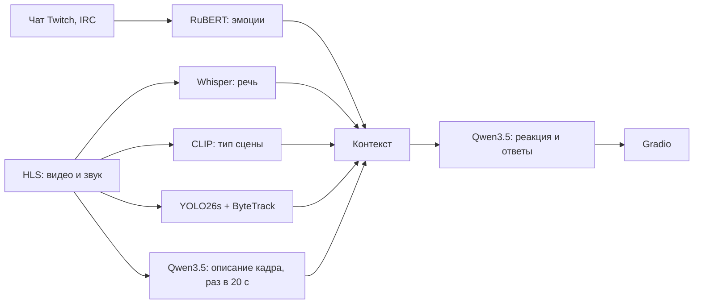

# llm-lab

Приложение из готовых предобученных моделей для анализа прямой трансляции Twitch. Каждая модель решает свою задачу на своём типе контента, а локальная LLM собирает их результаты в реакции и ответы на вопросы зрителя.

Отчёт по работе — [REPORT.md](REPORT.md); сценарий замеров — [TESTING.md](TESTING.md).

## Задачи и модели

| № | Задача | Модель | Фреймворк |
| --- | --- | --- | --- |
| 1 | Эмоции сообщений чата и тональность окна сообщений | `cointegrated/rubert-tiny2-cedr-emotion-detection` | Hugging Face Transformers |
| 2 | Распознавание русской речи | `openai/whisper-small` (для сравнения `whisper-large-v3-turbo`) | Hugging Face Transformers |
| 3 | Zero-shot классификация типа сцены кадра | `openai/clip-vit-base-patch32` | Hugging Face Transformers |
| 4 | Детекция и трекинг объектов в видео | YOLO26s + ByteTrack | Ultralytics |
| 5 | Реакции и ответы на вопросы по контексту; описание кадра | `qwen3.5:9b` | Ollama |

Модели 1–4 работают на CPU, LLM — в Ollama (на GPU, если он поддерживается). Обучения нет: классы сцены задаются текстовыми описаниями (`src/scene_classify.py`), поведение LLM — промптами (`src/prompts.py`).

## Как это устроено



Описание кадра от LLM хранится с отметкой времени и может отставать от текущего кадра. Реакции показываются в приложении и не отправляются в чат Twitch.

## Запуск

### Docker Compose

Нужны Docker с Compose и [Ollama](https://ollama.com/) на хосте с моделью `qwen3.5:9b`. Контейнеры обращаются к Ollama по `http://host.docker.internal:11434`, поэтому Ollama должна принимать подключения не только с loopback-интерфейса (переменная `OLLAMA_HOST`, см. [документацию](https://docs.ollama.com/faq#how-do-i-configure-ollama-server)).

```bash
cp .env.example .env
ollama pull qwen3.5:9b
docker compose up --build
```

| Сервис | Адрес |
| --- | --- |
| Gradio | http://localhost:7860 |
| FastAPI и Swagger UI | http://localhost:8000/docs |
| Prometheus | http://localhost:9090 |
| Grafana | http://localhost:3000 |

В Grafana включён анонимный доступ с ролью Admin; пароль администратора — `GRAFANA_PASSWORD` (по умолчанию `admin`). Для доступа извне локальной машины это нужно изменить.

### Локально

Нужны [uv](https://docs.astral.sh/uv/getting-started/installation/), FFmpeg в `PATH` и запущенная Ollama. Настройки читаются из переменных окружения (см. `.env.example`); адрес Ollama по умолчанию — `http://localhost:11434`.

```bash
uv sync --locked
ollama pull qwen3.5:9b
uv run --locked python -m src.web_ui   # или make run
uv run --locked python -m src.api      # или make api
```

Веса моделей скачиваются при первом запуске.

## Веб-интерфейс

| Вкладка | Что делает |
| --- | --- |
| Текст | Эмоции и тональность одного сообщения или набора сообщений |
| Аудио | Распознавание речи из файла или с микрофона |
| Изображение (CLIP) | Тип сцены кадра и вероятности по классам |
| Видео | Детекция объектов на кадре (трекинг — на вкладке Twitch) |
| LLM | Диалог с локальной моделью с необязательным контекстом |
| LLM о кадре | Вопрос к LLM о загруженном кадре |
| Twitch | Живой анализ канала: видео с трекингом, чат, речь, тип сцены, реакции и вопросы по контексту |

Консольный режим трансляции без веб-интерфейса:

```bash
uv run --locked python -m src.twitch_live_stream --channel <канал> --quality 480p --interval 10
```

## REST API

Основной маршрут — модель задачи 1; остальные дают доступ к моделям 3–5.

| Метод и маршрут | Назначение |
| --- | --- |
| `POST /api/text/sentiment` | Эмоции и тональность одного сообщения |
| `POST /api/text/batch-sentiment` | Пакет до 500 сообщений: доли тональностей и итоговое настроение |
| `POST /api/image/scene` | Тип сцены кадра (CLIP) |
| `POST /api/video/detect-frame` | Объекты на изображении (YOLO) |
| `POST /api/image/vlm` | Вопрос к LLM о кадре |
| `POST /api/llm/generate-reaction` | Реакция LLM по речи, настроению и описанию кадра |
| `GET /metrics` | Метрики Prometheus |

```bash
curl -X POST http://localhost:8000/api/text/sentiment -H "Content-Type: application/json" -d '{"text":"Отличный момент!"}'
```

## Оценка моделей

Каждая задача оценивается своим скриптом из `evals/`; результат сохраняется в `results/<задача>/<дата>_<commit>.json`. Подготовка данных и порядок прогонов — в [TESTING.md](TESTING.md).

| Команда | Что измеряется |
| --- | --- |
| `make eval-text` | Macro-F1 эмоций на тесте CEDR, латентность |
| `make eval-audio` | WER, CER, RTF на тесте FLEURS (ru); галлюцинации на фрагментах без речи |
| `make eval-image` | Accuracy и macro-F1 типа сцены на размеченных кадрах |
| `make eval-video` | mAP@0.5 на размеченных кадрах; ошибка подсчёта объектов трекером; FPS |
| `make eval-llm` | Ответы LLM на 30 сценариев; затем ручная оценка и `make eval-llm-review` |
| `make summary-table` | Сводная таблица последних результатов |
| `make report-pdf` | PDF отчёта в `build/REPORT.pdf` (нужен Chrome или Chromium) |

Зависимости для оценки ставятся отдельно: `uv sync --locked --group eval`.

## Мониторинг

Prometheus собирает с API и веб-приложения задержки моделей, число запросов и ошибок, токены и скорость генерации LLM, возраст описания кадра и наличие модели в памяти Ollama. В Grafana три панели: трансляция, модели и API, ресурсы процессов. Конфигурация — `monitoring/`, генератор панелей — `scripts/build_3_dashboards.py`.

## Разработка

| Команда | Назначение |
| --- | --- |
| `make install` | Зависимости и Git-хук pre-commit |
| `make check` | Ruff и юнит-тесты |
| `make format` | Форматирование Ruff |
| `make pre-commit` | Все проверки pre-commit |
| `make lock` | Обновить `uv.lock` |

[CI](.github/workflows/ci.yml) проверяет `uv.lock`, запускает `make check` и pre-commit на Ubuntu с Python 3.11. Тесты не требуют Twitch, Ollama и весов моделей.
