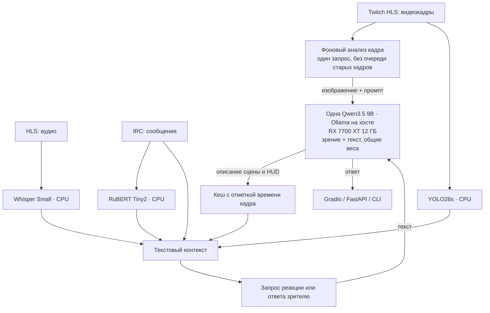

# ai lab — мультимодальный анализатор трансляций

Текущий профиль: `OLLAMA_MODEL=qwen3.5:9b`, `VISION_BACKEND=ollama`, `OLLAMA_CONTEXT=4096`. Одна модель в Ollama обслуживает зрение и диалог. Для воспроизведения прежнего этапа: `VISION_BACKEND=transformers`, `OLLAMA_MODEL=qwen3:8b`.

Проект лабораторной работы №1: анализирует чат, речь и видеоряд трансляции Twitch с помощью готовых моделей машинного обучения, объединяет результаты в контекст и формирует реакцию через локальную LLM. Для исследования отдельных моделей доступны веб-интерфейс Gradio, REST API FastAPI и консольные команды. Модели используются для инференса, без дообучения.

## Что умеет система

| Задача | Модель и инструмент | Результат |
| --- | --- | --- |
| Эмоции чата | `cointegrated/rubert-tiny2-cedr-emotion-detection`, Transformers/PyTorch | Шесть эмоций и общая тональность чата |
| Распознавание речи | `openai/whisper-small`, Transformers/PyTorch | Текст речи стримера; ограничение генерации защищает от повторов на паузах |
| Сравнение с прошлым этапом | `Salesforce/blip-image-captioning-large`, Transformers/PyTorch | Ручной эксперимент с описанием сцены |
| Подробный анализ кадра | `qwen3.5:9b`, локальный Ollama | Ответ на вопрос о кадре, включая игровой интерфейс и текст |
| Детекция объектов | `yolo26s.pt`, Ultralytics/OpenCV | Объекты, рамки и FPS для видео или веб-камеры |
| Генерация реакции | `qwen3.5:9b`, Ollama | Ответ с учётом речи, настроения чата и визуального контекста |

По умолчанию зрение и диалог обслуживает одна `qwen3.5:9b` в локальном Ollama. Фоновый анализ кадра обновляет описание сцены и HUD; реакции и ответы используют готовый контекст вместе с речью, чатом и объектами YOLO. BLIP и отдельная Qwen2-VL сохранены для сравнения с прежним этапом.

### Общая архитектурная схема мультимодального конвейера



## Быстрый запуск через Docker Compose

Нужны Docker с Compose и запущенный [Ollama](https://ollama.com/) с загруженной моделью `qwen3.5:9b`. В стандартной конфигурации Ollama работает **на хосте**, а контейнеры обращаются к нему по `http://host.docker.internal:11434`. На хосте Ollama должен принимать подключения с этого адреса, а не только с loopback-интерфейса.

```bash
cp .env.example .env
ollama pull qwen3.5:9b
docker compose up --build
```

В PowerShell вместо `cp` можно использовать `Copy-Item .env.example .env`. Настройки проекта хранятся в локальном `.env`, который исключён из Git; в репозитории находится только `.env.example` без личных данных. Измените модель, порты или адрес Ollama в `.env`. Compose поднимает Gradio, FastAPI, Prometheus и Grafana; модели Transformers и Ultralytics загружаются при первом запуске, поэтому он может занять время. Если хотите использовать Ollama в контейнере, запустите профиль `internal-ollama`, загрузите модель в этот контейнер и задайте `OLLAMA_BASE_URL=http://ollama:11434` для сервисов приложения.

| Сервис | Адрес |
| --- | --- |
| Gradio | [http://localhost:7860](http://localhost:7860) |
| FastAPI и Swagger UI | [http://localhost:8000/docs](http://localhost:8000/docs) |
| Метрики API | [http://localhost:8000/metrics](http://localhost:8000/metrics) |
| Prometheus | [http://localhost:9090](http://localhost:9090) |
| Grafana | [http://localhost:3000](http://localhost:3000) |

Для остановки используйте `docker compose down`. Значения портов и пароль Grafana (`admin` по умолчанию) задаются в `compose.yaml` и `.env`.

## Локальный запуск без Docker

Для захвата и декодирования трансляции нужен FFmpeg в `PATH`. Модели загружаются при первом обращении, затем инференс выполняется локально.

Из корня репозитория установите зависимости с помощью [uv](https://docs.astral.sh/uv/getting-started/installation/) (Python 3.11–3.14). `uv` сам создаст `.venv`, а версии возьмёт из `uv.lock`:

```bash
uv sync --locked
ollama pull qwen3.5:9b
```

Для локального запуска адрес Ollama по умолчанию — `http://localhost:11434`; если переменная `OLLAMA_BASE_URL` задана для Docker, измените её на локальный адрес. Gradio и API запускаются в отдельных терминалах:

```bash
uv run --locked python -m src.web_ui
uv run --locked python -m src.api
```

При наличии GNU Make используйте `make install`, `make run`, `make api`, `make test`, `make lint`, `make format` или `make check`. На Windows Make можно установить отдельно или запускать через WSL/MSYS2; команды `uv` выше работают и в PowerShell.

В Gradio есть семь вкладок: текст, аудио, описание кадра BLIP, анализ кадра общей моделью Ollama, видео YOLO, локальная LLM и живой стрим Twitch.

## Консольные сценарии

Каждую модальность можно проверить отдельно из корня проекта:

| Команда | Назначение |
| --- | --- |
| `uv run --locked python -m src.nlp_sentiment` | Анализ эмоций сообщений чата |
| `uv run --locked python -m src.audio_transcribe` | Распознавание аудиофрагмента через Whisper |
| `uv run --locked python -m src.image_classify` | Описание кадра через BLIP; CNN-классификация доступна при выборе соответствующей модели |
| `uv run --locked python -m src.video_live` | Детекция объектов с веб-камеры; выход из окна — `q` |
| `uv run --locked python -m src.llm_brain` | Генерация реакции локальной LLM |
| `uv run --locked python -m src.bot_pipeline` | Один цикл объединённого анализа |

Для подключения к активному каналу Twitch без API-ключа:

```bash
uv run --locked python -m src.twitch_live_stream --channel <имя_канала> --quality 480p --interval 10
```

`--quality` задаёт доступное качество потока, `--interval` — интервал быстрого анализа, `--vlm-interval` — интервал фонового анализа изображения (по умолчанию 20 секунд), `--no-display` отключает окно OpenCV, `--cycles` ограничивает число циклов. Для чтения публичного чата используется анонимное IRC-подключение. Во вкладке живого стрима Gradio показан последний анализ VLM и доступен ползунок его интервала.

## REST API

После запуска `uv run --locked python -m src.api` схемы запросов и примеры доступны в `/docs`. Основные маршруты:

| Метод и маршрут | Назначение |
| --- | --- |
| `GET /` | Статус сервиса |
| `GET /metrics` | Метрики Prometheus |
| `POST /api/text/sentiment` | Анализ одного сообщения |
| `POST /api/text/batch-sentiment` | Анализ пакета сообщений |
| `POST /api/image/classify` | Описание или классификация загруженного кадра |
| `POST /api/image/vlm` | Подробный анализ кадра с вопросом `prompt` |
| `POST /api/video/detect-frame` | Детекция объектов на изображении |
| `POST /api/llm/generate-reaction` | Генерация реакции по мультимодальному контексту |

Например, запрос к текстовой модели:

```bash
curl -X POST http://localhost:8000/api/text/sentiment -H "Content-Type: application/json" -d '{"text":"Отличный момент!"}'
```

Маршруты для изображений принимают загруженный файл как `multipart/form-data`. Подробные имена полей и форматы ответов смотрите в Swagger UI.

## Почему выбраны эти модели

Исходная CNN-классификация ResNet-50 возвращала общие классы ImageNet вроде `screen` и слабо описывала происходящее в игре. BLIP заменил жёсткие метки связным описанием кадра; Qwen2-VL добавлен для вопросов об интерфейсе и тексте, когда допустима более высокая задержка. YOLO26s решает отдельную задачу поиска объектов на кадре.

RuBERT Tiny2 CEDR определяет `joy`, `surprise`, `anger`, `sadness`, `fear` и `no_emotion`, после чего приложение сводит их к положительному, отрицательному или нейтральному фону. Whisper Small выбран для CPU после сравнения с Tiny и Large-v3-Turbo; при распознавании используются `max_new_tokens=64` и `no_repeat_ngram_size=3`. Qwen 3 работает через локальный HTTP API Ollama; режим `think: false` сокращает время ответа для коротких реплик.

## Мониторинг

Prometheus собирает метрики API и веб-сервиса: задержки моделей, число запросов, ошибки, события чата и возраст визуального контекста. В Grafana предусмотрены три панели: показатели трансляции, модели и API, ресурсы процессов приложения. Конфигурация находится в `monitoring/`, генератор панелей — `scripts/build_3_dashboards.py`.

## Разработка

Шаблон [CI для GitHub Actions](.github/ci.yml.example) сохранён отдельно. Для включения автоматических проверок переместите его в `.github/workflows/ci.yml` и загрузите с правом `workflow` у токена GitHub. После включения CI при изменениях в `main` и для pull request проверяет `uv.lock`, устанавливает зависимости через `uv`, выполняет `make check` (Ruff и тесты) и все проверки pre-commit. Для этих проверок не нужны Twitch, Ollama или загруженные веса моделей.

Перед первым коммитом установите Git-хук (`make install` также устанавливает его):

```bash
uv sync --locked
uv run --locked pre-commit install
```

При `git commit` pre-commit проверяет подготовленные файлы: исправляет ошибки Ruff, форматирует Python, проверяет YAML/TOML и маркеры конфликтов, убирает пробелы в конце строк и добавляет завершающий перевод строки. Если файлы исправлены, просмотрите изменения, повторно выполните `git add` и коммит. Версия Ruff берётся из `uv.lock`.

Ручной запуск всех проверок: `uv run --locked pre-commit run --all-files` или `make pre-commit`. После клонирования репозитория хук нужно установить заново; команда `make hooks` делает это без обновления зависимостей.

## Структура проекта

- `src/` — приложение, модели, коннекторы, API и веб-интерфейс.
- `tests/` — автоматические проверки.
- `scripts/` — генератор панелей Grafana, evals и проверка общей модели.
- `evals/` — сценарии оценки системы; `samples/` — примеры входных данных.
- `monitoring/` — конфигурация Prometheus и Grafana.
- `.github/`, Makefile и конфигурация pre-commit — автоматизация разработки.

Git содержит код, настройки запуска, инструменты разработки и README.md. Отчёты, учебные материалы, эксперименты, результаты прогонов, веса моделей и локальные настройки остаются на компьютере и исключены из Git.

## Локальные evals

Запустите API и Ollama, затем `make eval` (без Make: `uv run --locked python -m scripts.run_evals`).
13 синтетических сценариев проверяют тональность, зрение, реакции и связку «кадр → реакция»; по умолчанию три повтора.
Результаты сохраняются отдельно для каждого запуска в `output/evals/`. Для другого числа повторов используйте `make eval EVAL_ARGS="--repeats 5"`. Для обработки заполненной ручной оценки: `uv run --locked python -m scripts.run_evals --review output/evals/<каталог-прогона>`.
`make eval-validate` проверяет набор без обращения к моделям. Windows Exporter удалён; CPU/RAM в Grafana относятся к процессам приложения.
