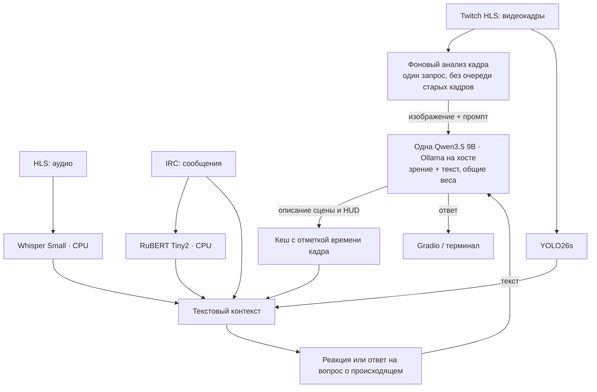

# llm-lab

Проект для изучения возможностей готовых моделей в решении разных задач: определение эмоций и тональности текста, распознавание речи, описание изображений, ответы на вопросы о кадре, детекция объектов и диалог с локальной языковой моделью (LLM).

Каждую задачу можно исследовать отдельно: передать свои данные, получить результат, оценить ограничения модели и сравнить доступные подходы. Веб-интерфейс Gradio объединяет эти инструменты в одном приложении; REST API предоставляет программный доступ, а отдельные модули можно запускать из терминала.

Дополнительно модели могут работать совместно: результаты анализа текста, речи и кадров становятся контекстом для реакций LLM и ответов на вопросы о происходящем. Пример такой интеграции — обработка потока Twitch.

## Задачи и модели

| Задача | Модель и инструмент | Результат |
| --- | --- | --- |
| Эмоции и тональность текста | `cointegrated/rubert-tiny2-cedr-emotion-detection`, Transformers/PyTorch | Эмоции сообщения и тональность набора сообщений |
| Распознавание речи | `openai/whisper-small`, Transformers/PyTorch | Распознанный текст речи; ограничение генерации и фильтрация повторов |
| Описание изображения | `Salesforce/blip-image-captioning-large`, Transformers/PyTorch | Текстовое описание сцены |
| Подробный анализ кадра | `qwen3.5:9b`, локальный Ollama | Ответ на вопрос о кадре, включая игровой интерфейс и текст |
| Детекция объектов | `yolo26s.pt`, Ultralytics/OpenCV | Объекты, рамки и FPS для видео или веб-камеры |
| Диалог с LLM | `qwen3.5:9b`, Ollama | Ответ на промпт с необязательными инструкциями, контекстом и историей диалога |

## Как это устроено

Основным задачам соответствуют модули обработки и вкладки Gradio. Модули принимают сообщения, аудиофайлы, изображения или промпты и возвращают результат вместе со временем обработки. Для работы с отдельной моделью результаты других моделей не требуются.

Текст, речь и объекты обрабатываются через Transformers/PyTorch и Ultralytics. По умолчанию анализ кадра и диалог используют одну `qwen3.5:9b` в локальном Ollama. BLIP доступен отдельно для описания изображений; Qwen2-VL — как альтернативная модель зрения через Transformers.

## Быстрый запуск через Docker Compose

Docker Compose запускает Gradio, FastAPI, Prometheus и Grafana. Команды ниже выполняются из корня репозитория.

### Настройка

Текущий профиль: `OLLAMA_MODEL=qwen3.5:9b`, `VISION_BACKEND=ollama`, `OLLAMA_CONTEXT=4096`. Одна модель в Ollama обслуживает зрение и диалог. Альтернативный профиль с отдельной моделью зрения: `VISION_BACKEND=transformers`, `OLLAMA_MODEL=qwen3:8b`; отдельное зрение использует `VLM_MODEL=Qwen/Qwen2-VL-2B-Instruct`. Оба профиля доступны для сравнения подходов.

Минимальные требования к памяти и проверенные показатели скорости для конкретного оборудования в репозитории не зафиксированы.

Нужны Docker с Compose и запущенный [Ollama](https://ollama.com/) с загруженной моделью `qwen3.5:9b`. В стандартной конфигурации Ollama работает **на хосте**, а контейнеры обращаются к нему по `http://host.docker.internal:11434`. Ollama должен принимать подключения от контейнеров, а не только с loopback-интерфейса: адрес привязки задаётся переменной `OLLAMA_HOST` в окружении процесса Ollama ([настройка по ОС](https://docs.ollama.com/faq#how-do-i-configure-ollama-server)).

```bash
cp .env.example .env
ollama pull qwen3.5:9b
docker compose up --build
```

В PowerShell вместо `cp` можно использовать `Copy-Item .env.example .env`. Модель и адрес Ollama для Compose задаются в `.env`. Compose поднимает Gradio, FastAPI, Prometheus и Grafana; модели Transformers и Ultralytics загружаются при первом запуске, поэтому он может занять время.

| Сервис | Адрес | Назначение |
| --- | --- | --- |
| Gradio | [http://localhost:7860](http://localhost:7860) | Работа с моделями и диалог с LLM в браузере |
| FastAPI и Swagger UI | [http://localhost:8000/docs](http://localhost:8000/docs) | Повторяемые запросы и изучение форматов данных |
| Метрики API | [http://localhost:8000/metrics](http://localhost:8000/metrics) | Метрики запросов и моделей процесса API |
| Prometheus | [http://localhost:9090](http://localhost:9090) | Сбор метрик API и веб-приложения |
| Grafana | [http://localhost:3000](http://localhost:3000) | Наблюдение за моделями и запросами на панелях |

Для остановки используйте `docker compose down`. Пароль Grafana (`admin` по умолчанию) задаётся через `GRAFANA_PASSWORD`; в текущей конфигурации также включён анонимный доступ с ролью Admin. Адреса выше соответствуют стандартным портам. В текущем Compose `GRADIO_PORT` и `API_PORT` меняют опубликованные порты; сервисы внутри контейнеров остаются на 7860 и 8000. `WEB_METRICS_PORT` меняет и порт сервера метрик, тогда как правая часть `ports` и цель Prometheus остаются на 8001: для его изменения нужно согласовать эти настройки вручную.

## Использование

### Веб-интерфейс

После запуска Gradio доступен по адресу [http://localhost:7860](http://localhost:7860).

Интерфейс содержит семь вкладок:

| Вкладка | Входные данные и результат |
| --- | --- |
| Текст | Одно сообщение или набор сообщений → эмоции и тональность |
| Аудио | Аудиофайл или запись с микрофона → распознанная речь |
| Сравнение: BLIP Large | Изображение и необязательный промпт → описание сцены |
| Зрение (VLM & OCR) | Изображение и вопрос → описание, ответ о деталях кадра или прочитанный текст |
| Видео (YOLO26s) | Загруженный кадр или снимок с веб-камеры → рамки и классы объектов |
| LLM | Промпт, необязательные инструкции и контекст → ответ локальной модели |
| Twitch | Активный канал → анализ чата, речи и кадров, реакции и диалог по текущему контексту |

На вкладке LLM поле дополнительного контекста принимает, например, распознанную речь и описание изображения из других вкладок. В поле промпта можно запросить реакцию или задать вопрос: «Что происходит?», «Что было сказано?», «Как реагирует чат?». Режим сессии сохраняет историю диалога до очистки, переключения режима или обновления страницы. Отдельный REST-маршрут для диалога с историей и маршрут распознавания аудио в текущем API отсутствуют.

Один и тот же кадр можно передать BLIP и VLM: BLIP формирует описание сцены, а VLM отвечает на вопрос об изображении. Рядом с результатами отображается измеренное время обработки.

### Анализ потока Twitch

Вкладка Twitch принимает имя активного канала. После запуска она показывает видеокадры с объектами YOLO, сообщения чата, распознанную речь, описание сцены и реакцию LLM. Встроенный диалог позволяет задавать вопросы по автоматически собранному контексту. Реакции и ответы отображаются в приложении и не отправляются в чат Twitch.

Для этого режима нужны доступная трансляция и сетевое подключение. Чтение публичного чата выполняется через анонимное IRC-подключение. Интервал фонового анализа кадра настраивается в интерфейсе; новое описание появляется после завершения запроса к модели.

### Совместная работа моделей

Описание сцены, найденные объекты, распознанная речь и настроение сообщений можно объединить в контекст LLM. На его основе модель формулирует реакцию или отвечает на вопросы о происходящем.

При работе с файлами результаты отдельных вкладок передаются в контекст LLM вручную. В режиме Twitch приложение собирает контекст автоматически: фоновый анализ обновляет описание сцены и элементов игрового интерфейса (HUD), а реакции и ответы используют последнее описание вместе с речью, сообщениями и объектами YOLO. Визуальный контекст хранится с отметкой времени и может отставать от текущего кадра.

Ниже показана схема конвейера для потока Twitch:



## Дополнительные способы запуска

### Локально без Docker

Для захвата и декодирования трансляции нужен FFmpeg в `PATH`. В Gradio при запуске загружаются RuBERT, Whisper и YOLO; для Ollama создаются клиенты. При стандартном `VISION_BACKEND=ollama` BLIP загружается по ручному запросу. При `VISION_BACKEND=transformers` Gradio также загружает `VLM_MODEL` и `IMAGE_MODEL` (по умолчанию BLIP) при запуске. API при запуске инициализирует RuBERT, YOLO, выбранное зрение и клиент LLM; Whisper в нём не используется. После загрузки инференс выполняется локально.

Из корня репозитория установите зависимости с помощью [uv](https://docs.astral.sh/uv/getting-started/installation/) (в `pyproject.toml` указан Python 3.11–3.14; Docker и CI используют 3.11). `uv` сам создаст `.venv`, а версии возьмёт из `uv.lock`:

```bash
uv sync --locked
ollama pull qwen3.5:9b
```

При запуске Python настройки читаются из переменных окружения; файл `.env` автоматически использует только Compose. Адрес Ollama по умолчанию — `http://localhost:11434`; если переменная `OLLAMA_BASE_URL` задана для Docker, измените её на локальный адрес. Gradio и API запускаются в отдельных терминалах:

```bash
uv run --locked python -m src.web_ui
uv run --locked python -m src.api
```

При наличии GNU Make веб-интерфейс и API можно запустить через `make run` и `make api`. На Windows Make можно установить отдельно или запускать через WSL/MSYS2; команды `uv` выше работают и в PowerShell.

### Ollama в контейнере

Вместо Ollama на хосте можно использовать профиль Compose `internal-ollama`. Для стандартной модели:

```bash
docker compose --profile internal-ollama up -d ollama
docker compose exec ollama ollama pull qwen3.5:9b
```

Затем задайте в `.env` `OLLAMA_BASE_URL=http://ollama:11434` и запустите `docker compose --profile internal-ollama up --build`. Порт Ollama на хосте должен быть свободен. GPU для контейнера в `compose.yaml` не настроен.

### Запуск отдельных модулей

Отдельные модули и примеры обработки запускаются из терминала без веб-интерфейса. Команды выполняются из корня проекта:

| Команда | Назначение |
| --- | --- |
| `uv run --locked python -m src.nlp_sentiment` | Анализ встроенных примеров сообщений |
| `uv run --locked python -m src.audio_transcribe` | Пример обработки сгенерированного звукового тона; это не запись речи |
| `uv run --locked python -m src.image_classify` | Описание `samples/sample_stream.jpg` через `IMAGE_MODEL` (по умолчанию BLIP), если файл существует |
| `uv run --locked python -m src.video_live` | Детекция на синтетическом чёрном кадре |
| `uv run --locked python -m src.bot_pipeline` | Один цикл на сгенерированном тоне, сером кадре и встроенных сообщениях |

Эти команды запускают встроенные примеры, а не принимают произвольные файлы как аргументы. Для своих данных доступны Gradio и соответствующие REST-маршруты. В `src.llm_brain` нет исполняемого примера; диалог доступен в Gradio. Метод `LiveStreamVideoDetector.run_live_feed()` поддерживает веб-камеру или видеофайл и окно OpenCV с выходом по `q`; команда `src.video_live` его не вызывает. CNN-классификация доступна через класс `StreamImageClassifier` при явном выборе соответствующей модели.

Для подключения к активному каналу Twitch без API-ключа:

```bash
uv run --locked python -m src.twitch_live_stream --channel <имя_канала> --quality 480p --interval 10
```

`--quality` задаёт доступное качество потока, `--interval` — интервал основного анализа, `--vlm-interval` — минимальный интервал между запусками фонового анализа изображения (по умолчанию 20 секунд), `--no-display` отключает окно OpenCV, `--cycles` ограничивает число циклов. Для чтения публичного чата используется анонимное IRC-подключение. Во вкладке живого стрима Gradio показан последний анализ VLM и доступен ползунок его интервала.

## REST API

FastAPI предоставляет программный доступ к моделям для экспериментов, сравнения ответов и синтетических evals. `GET /` сообщает о доступности HTTP-сервиса; он не проверяет успешность инференса всех моделей.

Схемы запросов и примеры доступны в `/docs` работающего API; при стандартных портах это [http://localhost:8000/docs](http://localhost:8000/docs). Основные маршруты:

| Метод и маршрут | Назначение |
| --- | --- |
| `GET /` | Статус сервиса |
| `GET /metrics` | Метрики Prometheus |
| `POST /api/text/sentiment` | Анализ одного сообщения |
| `POST /api/text/batch-sentiment` | Анализ пакета сообщений |
| `POST /api/image/classify` | Анализ загруженного кадра выбранной VLM; необязательный `prompt` |
| `POST /api/image/vlm` | Подробный анализ кадра с вопросом `prompt` |
| `POST /api/video/detect-frame` | Детекция объектов на изображении |
| `POST /api/llm/generate-reaction` | Генерация реакции по мультимодальному контексту |

Например, запрос к текстовой модели:

```bash
curl -X POST http://localhost:8000/api/text/sentiment -H "Content-Type: application/json" -d '{"text":"Отличный момент!"}'
```

Ответы на вопросы по объединённому контексту доступны в Gradio: на вкладке LLM контекст передаётся вручную, на вкладке Twitch собирается из потока. Маршрут `/api/llm/generate-reaction` предназначен для генерации реакции и не имеет отдельного поля вопроса.

Оба маршрута `/api/image/classify` и `/api/image/vlm` используют `create_vision_classifier()`: при `VISION_BACKEND=ollama` это модель Ollama, при `transformers` — `VLM_MODEL`. Отдельного маршрута для BLIP или CNN-классификации нет.

Маршруты для изображений принимают загруженный файл как `multipart/form-data`. Подробные имена полей и форматы ответов смотрите в Swagger UI.

## Выбор моделей и сравнение подходов

CNN-классификация ResNet-50 ограничена классами ImageNet и не формирует описание происходящего в игре. BLIP формирует связное описание вместо фиксированной метки класса. Qwen2-VL и общая модель Ollama позволяют задавать вопросы об интерфейсе и тексте; их ответы можно сравнивать с общими описаниями BLIP. YOLO26s решает отдельную задачу поиска объектов на кадре.

RuBERT Tiny2 CEDR оценивает `joy`, `surprise`, `anger`, `sadness`, `fear` и `no_emotion`. Приложение выбирает метку с максимальным значением и по собственному правилу сводит её к тональности: `joy` и `surprise` — положительная, `anger`, `sadness`, `fear` — отрицательная, `no_emotion` — нейтральная. Это упрощённая интерпретация эмоций, а не отдельная модель тональности. Whisper Small используется на CPU. Через `WHISPER_MODEL` можно задать другую модель семейства Whisper, например Tiny или Large-v3-Turbo. Воспроизводимые результаты сравнения этих вариантов в репозитории не приведены. При распознавании используются `max_new_tokens=64` и `no_repeat_ngram_size=3`. Qwen работает через локальный HTTP API Ollama с `think: false`. Предполагается, что отключение рассуждений уменьшит время коротких ответов; эффект нужно измерять в конкретной конфигурации.

Назначение моделей описано в карточках авторов: [RuBERT CEDR](https://huggingface.co/cointegrated/rubert-tiny2-cedr-emotion-detection), [Whisper Small](https://huggingface.co/openai/whisper-small), [BLIP Large](https://huggingface.co/Salesforce/blip-image-captioning-large), [Qwen2-VL](https://huggingface.co/Qwen/Qwen2-VL-2B-Instruct), [Qwen3.5 в Ollama](https://ollama.com/library/qwen3.5:9b), [YOLO26](https://docs.ultralytics.com/models/yolo26). Их внешние бенчмарки не являются результатами проверки этого приложения.

### Ограничения

Сравнение подходов основано на различии их задач: фиксированные классы, общее описание сцены и ответы на конкретные вопросы. Оно не подтверждает превосходство одной модели по качеству или скорости. Для воспроизводимого сравнения нужны одинаковые входные данные и вопросы, сохранённые ответы и настройки; время загрузки модели учитывается отдельно от последующих запросов.

Речь на фоне музыки, ирония в чате, мелкий текст и игровой интерфейс могут приводить к ошибкам. Ограничение длины генерации и фильтры Whisper не исключают выдуманный текст и могут обрезать полезную речь. Классы YOLO не охватывают все игровые объекты. Модели зрения (VLM) и LLM могут добавлять детали, которых нет во входных данных; ответы нужно сверять с кадром и контекстом. В адаптере Transformers для генерируемых описаний поле `confidence` и оценка в `predictions` заданы константами 0.96 (BLIP) или 0.98 (VLM), а адаптер Ollama возвращает `confidence=0.0`: эти числа не измеряют достоверность описания. Задержки зависят от оборудования, входных данных и одновременных запросов к общей модели.

## Мониторинг

Prometheus собирает метрики API и веб-сервиса: задержки моделей, число запросов, ошибки, события чата и возраст визуального контекста. В Grafana предусмотрены три панели: показатели трансляции, модели и API, ресурсы процессов приложения. Панели показывают поведение моделей и запросов во время работы приложения. CPU/RAM на панелях относятся к процессам приложения, а не ко всему хосту или Ollama. Отдельно отображаются доступность Ollama, модели в памяти и выделенная им видеопамять по `/api/ps`; это не общая загрузка GPU. Вне Compose Prometheus и Grafana нужно запускать отдельно и настраивать адреса сбора метрик. Конфигурация находится в `monitoring/`, генератор панелей — `scripts/build_3_dashboards.py`.

## Оценка на синтетических сценариях (evals)

Запустите API и Ollama, затем `make eval` (без Make: `uv run --locked python -m scripts.run_evals`).
13 синтетических сценариев проверяют тональность, зрение, реакции и связку «кадр → реакция»; по умолчанию три повтора.
Результаты сохраняются отдельно для каждого запуска в `output/evals/`. Для другого числа повторов используйте `make eval EVAL_ARGS="--repeats 5"`. Для обработки заполненной ручной оценки: `uv run --locked python -m scripts.run_evals --review output/evals/<каталог-прогона>`.
`make eval-validate` проверяет набор без обращения к моделям. Это синтетические примеры, а не оценка качества на реальных трансляциях: аудио и YOLO в этот набор не входят. Автоматические проверки шаблонов ответа и времени дополняются ручной оценкой корректности, уместности и опоры на контекст. `deadline_ms` — заданный порог сценария, а не измеренный результат. Результаты конкретного прогона следует интерпретировать вместе с его конфигурацией; наличие сценариев само по себе не подтверждает качество или скорость моделей.

## Разработка

Make:
| Команда | Назначение |
| --- | --- |
| `make help` | Показать список команд |
| `make install` | Установить зависимости и Git-хук pre-commit |
| `make hooks` | Установить Git-хук pre-commit отдельно |
| `make run` | Запустить Gradio |
| `make api` | Запустить FastAPI |
| `make pipeline` | Запустить встроенный пример объединённого анализа |
| `make docker-up` | Собрать и запустить сервисы Compose в фоне |
| `make docker-down` | Остановить сервисы Compose |
| `make test` | Запустить тесты |
| `make lint` | Проверить Python-код с помощью Ruff |
| `make format` | Отформатировать Python-код с помощью Ruff |
| `make check` | Запустить Ruff и тесты |
| `make pre-commit` | Запустить все проверки pre-commit для файлов репозитория |
| `make eval` | Выполнить синтетические сценарии через запущенный локальный API |
| `make eval-validate` | Проверить набор сценариев без обращения к моделям |
| `make lock` | Обновить `uv.lock` по ограничениям из `pyproject.toml` |

Pre-commit проверяет подготовленные файлы при коммите: запускает Ruff с автоисправлениями и форматированием, проверяет YAML/TOML, маркеры конфликтов и пробельные символы. Хук устанавливается для каждой локальной копии репозитория через `make install` или `make hooks`.

[CI](.github/workflows/ci.yml) выполняет проверку `uv.lock`, `make check` и pre-commit на Ubuntu с Python 3.11. Запуск — при push в `main`, для pull request или вручную на вкладке Actions. Проверки не требуют Twitch, Ollama и весов моделей.
