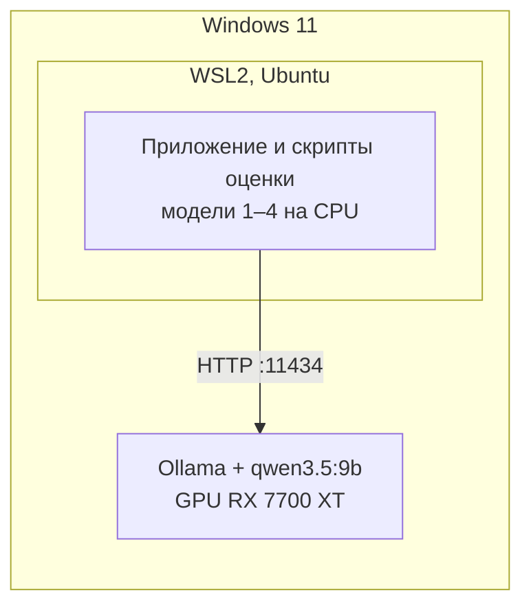
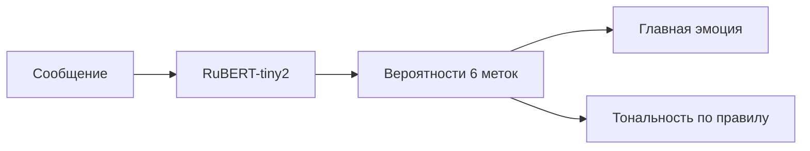
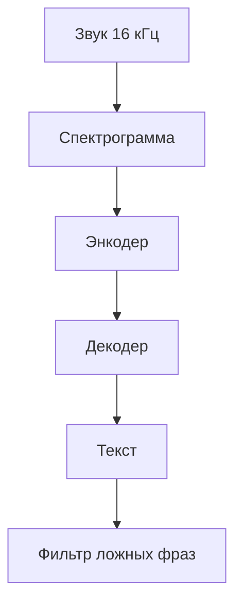
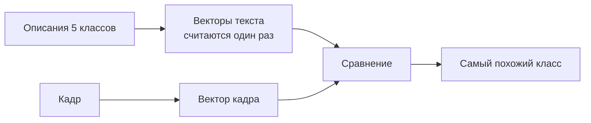
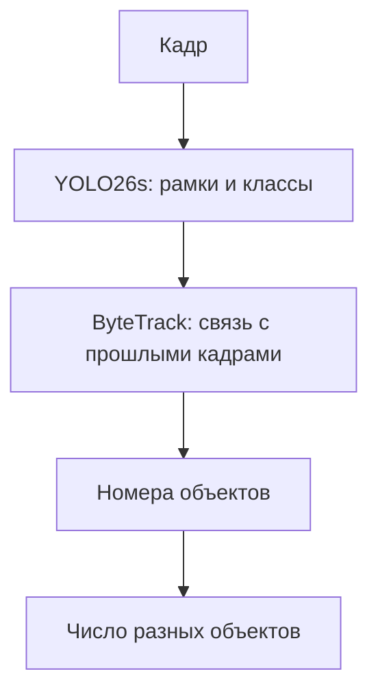
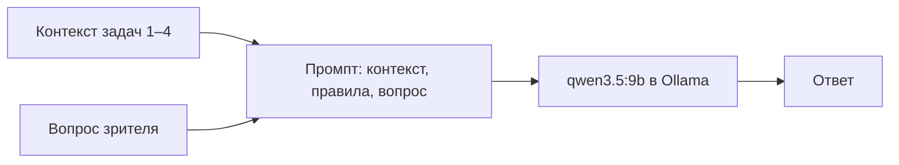
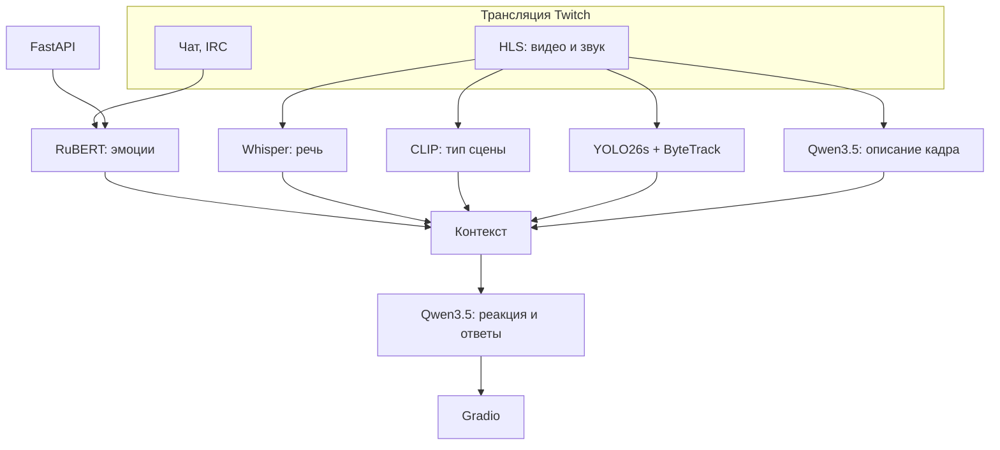

## 1 Цель работы и постановка задач

**Цель работы** — научиться создавать приложения на основе готовых библиотек и предобученных моделей машинного обучения: выбрать прикладные задачи для разных типов контента, подобрать под них модели, развернуть их локально, измерить качество, скорость и потребление ресурсов, обеспечить мониторинг и воспроизводимость результатов.

По заданию требуется решить четыре задачи на разных типах контента (текст, аудио, изображение, видео) и дополнительно развернуть локальную большую языковую модель (LLM). Решения должны использовать не менее двух фреймворков. Модели не обучаются и не дообучаются: используются только готовые веса. Для одной из моделей в дальнейшем будет разрабатываться API, поэтому её выбор нужно обосновать заранее.

Все задачи объединены общим прикладным сценарием. Приложение наблюдает за прямой трансляцией на Twitch и помогает зрителю понять, что в ней происходит. Каждая модель обрабатывает свой канал данных трансляции (таблица 1), а LLM собирает их результаты в короткие реакции и ответы на вопросы зрителя.

Таблица 1 – Каналы данных трансляции и решаемые задачи

| Канал трансляции | Тип контента | Результат |
| --- | --- | --- |
| Чат (IRC) | Текст | Эмоции сообщений и настроение чата |
| Звук (HLS) | Аудио | Текст речи стримера |
| Кадр (HLS) | Изображение | Тип сцены: игра, меню, загрузка, камера стримера, заставка |
| Видеопоток (HLS) | Видео | Объекты в кадре и число разных объектов за сессию |
| Результаты задач 1–4 | LLM | Реакция и ответы на вопросы зрителя |

Сценарий объясняет выбор задач, но каждая задача в разделах 4–8 описана и оценена отдельно, на своём тестовом наборе. Облачные API не используются: интернет нужен только для скачивания весов моделей и получения самой трансляции. Пользовательские интерфейсы — веб-приложение Gradio, REST API на FastAPI и консольные скрипты.

Работа выполнена с инженерной стороны: основное внимание уделено выбору моделей, развёртыванию, измерениям и эксплуатации. Внутреннее устройство моделей описано кратко; подробности вынесены в приложение В, термины поясняются в приложении Д.

## 2 Выбор задач, моделей и фреймворков

### 2.1 Выбранные модели

Пять задач закрывают четыре типа контента и LLM (таблица 2). Используются три фреймворка: Hugging Face Transformers [1], Ultralytics [11] и Ollama [17]. На уровне вычислительного движка их два — PyTorch под Transformers и Ultralytics и llama.cpp под Ollama, поэтому требование «не менее двух фреймворков» выполняется в обоих прочтениях.

Таблица 2 – Выбранные модели и фреймворки

| № | Тип контента | Задача | Модель | Фреймворк | Размер | Где работает |
| --- | --- | --- | --- | --- | --- | --- |
| 1 | Текст | Эмоции сообщений чата и настроение окна сообщений | rubert-tiny2-cedr-emotion-detection [2] | Transformers | 29 млн параметров, 117 МБ | CPU |
| 2 | Аудио | Распознавание русской речи | whisper-small [5]; для сравнения whisper-large-v3-turbo [6] | Transformers | 244 млн / 809 млн параметров | CPU |
| 3 | Изображение | Определение типа сцены по кадру | CLIP ViT-B/32 [9] | Transformers | ≈151 млн параметров, 605 МБ | CPU |
| 4 | Видео | Поиск объектов и их отслеживание между кадрами | YOLO26s + ByteTrack [11, 13] | Ultralytics | 9,5 млн параметров | CPU |
| 5 | LLM | Реакция и ответы на вопросы по контексту трансляции | qwen3.5:9b [15, 16] | Ollama | 9 млрд параметров, 6,6 ГБ | GPU |

Каждая задача даёт сценарию свой сигнал и имеет измеримый критерий качества (таблица 3). Для задачи 3 выбран zero-shot подход: классы сцены задаются текстовыми описаниями без обучения, что укладывается в ограничение «только готовые модели» и при этом даёт классы, нужные сценарию. Трекинг в задаче 4 делает её именно видеозадачей: результат зависит от последовательности кадров, а не от одного кадра.

Таблица 3 – Роль задач в сценарии и метрики качества

| Задача | Что даёт сценарию | Чем измеряется качество |
| --- | --- | --- |
| Текст | Настроение чата — сигнал, на который реагирует LLM | Macro-F1 на тестовой части набора CEDR |
| Аудио | Слова стримера — главный источник смысла происходящего | WER на тестовой части FLEURS (русский) |
| Изображение | Тип сцены — дешёвый сигнал, которого нет у детектора объектов | Macro-F1 на собственном размеченном наборе кадров |
| Видео | Какие и сколько разных объектов в потоке | mAP@0.5 на размеченных кадрах, ошибка подсчёта объектов, FPS |
| LLM | Связывает сигналы задач 1–4 в ответ | Ручная оценка ответов и доля выдуманных фактов |

Задачу изображения и LLM важно разделить. Qwen3.5 тоже умеет описывать кадры, и в приложении это используется как дополнительный контекст для LLM, но решением задачи 3 не считается: её решает CLIP. Задание ориентирует на LLM размером 2–8 млрд параметров; у выбранной модели 8,95 млрд. Обоснование приведено в подразделе 8.3.

### 2.2 Модель для будущего API

Для API выбрана модель задачи 1 — rubert-tiny2-cedr-emotion-detection. Она маленькая и работает на CPU за миллисекунды, поэтому сервису не нужен GPU. Одинаковый текст всегда даёт одинаковый ответ, что упрощает тестирование и кэширование. Контракт простой: текст или список текстов на входе, метки и вероятности на выходе (подраздел 9.4). Для модели есть публичный тестовый набор, поэтому качество через API проверяется той же метрикой, что и в отчёте.

## 3 Методика оценки

### 3.1 Стенд

Все замеры выполнены на одном стенде (таблица 4). Каждая задача оценивается отдельным скриптом из каталога `evals/` на зафиксированном наборе данных. Результат сохраняется в файл `results/<задача>/<дата>_<commit>.json` вместе с версиями библиотек, параметрами запуска и описанием окружения.

Таблица 4 – Конфигурация стенда

| Параметр | Значение |
| --- | --- |
| Процессор | AMD Ryzen 5 7500F, 6 ядер / 12 потоков |
| Видеокарта | AMD Radeon RX 7700 XT, 12 ГБ видеопамяти |
| Оперативная память | 32 ГБ DDR5 |
| Операционная система | Windows 11 ‹сборка›; код и замеры — в WSL2, Ubuntu ‹версия› |
| Python | ‹версия из `results/*.json`› |
| Библиотеки | ‹PyTorch, Transformers, Ultralytics, datasets, jiwer — версии из `results/*.json`›; полный список — `uv.lock` |
| LLM-рантайм | Ollama ‹версия› для Windows |

Модели 1–4 работают на CPU внутри WSL2. Это простой и воспроизводимый вариант: PyTorch в проекте собран под CPU, а работа PyTorch с видеокартами AMD внутри WSL2 официально не подтверждена. LLM — самая тяжёлая модель, ей нужен GPU, а Ollama официально поддерживает RX 7700 XT в Windows [17]. Поэтому Ollama запущена в Windows, и приложение обращается к ней из WSL2 по HTTP (рисунок 1). Для доступа используется зеркальный сетевой режим WSL [19].



Рисунок 1 – Размещение компонентов на стенде

Модели 1–4 занимают оперативную память процесса; в отчёт идёт её пиковое значение (RSS). LLM занимает видеопамять, объём берётся из команды `ollama ps`. Если модель не помещается в 12 ГБ целиком, часть её вычислений уходит на CPU и скорость резко падает; это проверяется в подразделе 8.5.

### 3.2 Тестовые данные

Для задач 1 и 2 используются публичные тестовые наборы, для задач 3–5 — собственные (таблица 5). Подвыборки детерминированы: seed фиксирован, порядок примеров сохраняется. Кадры и клипы чужих трансляций хранятся только локально в каталоге `evals/local/`, исключённом из git; в репозиторий попадают только разметка и подсчёты.

Таблица 5 – Тестовые наборы данных

| Задача | Набор | Объём | Кто разметил | В репозитории |
| --- | --- | --- | --- | --- |
| Текст | CEDR, тестовая часть [3] | 1 882 предложения | Авторы набора | Скачивается скриптом |
| Аудио | FLEURS, русский, тестовая часть [7] | 300 из 775 записей | Авторы набора | Скачивается скриптом |
| Аудио, шум | Собственный: фрагменты без речи | ‹≥ 20› фрагментов по 3–5 с | Не нужна: правильный ответ — пустая строка | Нет |
| Изображение | Собственный: кадры трансляций | ‹≥ 200› кадров, 5 классов, ≥ 30 на класс, ‹≥ 8› каналов | Вручную по правилам приложения Г | CSV разметки |
| Видео, детекция | Собственный: кадры трансляций | ‹≥ 100› кадров, ‹≥ 5› каналов | Рамки вручную по правилам приложения Г | Нет |
| Видео, трекинг | Собственный: клипы трансляций | ‹≥ 10› клипов по 30 с | Число разных объектов считает человек | CSV подсчётов |
| LLM | Собственный: `evals/data/llm_scenarios.json` | 30 сценариев, из них 8 «ловушек» | Ожидаемые факты заданы заранее | Целиком |

«Ловушка» — вопрос о факте, которого нет в контексте. Правильный ответ на неё — сказать, что данных нет; любой конкретный ответ считается выдумкой (галлюцинацией).

### 3.3 Метрики

Метрики разделены на три группы (таблица 6). ML-метрики показывают, правильно ли модель решает задачу, продуктовые — полезен ли результат пользователю, инфраструктурные — сколько стоит работа модели. Во время работы приложения инфраструктурные метрики дополнительно собирает Prometheus (подраздел 9.5), но числа в отчёте берутся только из скриптов оценки.

Таблица 6 – Группы метрик

| Группа | На какой вопрос отвечает | Примеры | Как снимается |
| --- | --- | --- | --- |
| ML-метрики | Правильно ли модель решает задачу | Macro-F1, WER, mAP@0.5, ручная оценка ответов | Скрипт оценки на наборе из таблицы 5 |
| Продуктовые | Полезен ли результат пользователю | Ошибка подсчёта объектов, ложный текст на тишине, время до первого слова ответа | Скрипт оценки |
| Инфраструктурные | Сколько стоит работа модели | Задержка p50/p95, RTF, FPS, память, видеопамять, время загрузки, токенов в секунду | Таймеры в скрипте, `psutil`, ответ Ollama |

Главные ML-метрики считаются по стандартным формулам. Для классификации F1 по классу k объединяет точность P и полноту R, а macro-F1 усредняет F1 по всем K классам, так что редкие классы весят столько же, сколько частые:

<p class="formula">F1<sub>k</sub> = 2·P<sub>k</sub>·R<sub>k</sub> / (P<sub>k</sub> + R<sub>k</sub>),   macro-F1 = (F1<sub>1</sub> + … + F1<sub>K</sub>) / K.</p>

Для распознавания речи WER — доля ошибок в словах, где S, D и I — число заменённых, пропущенных и вставленных слов, а N — число слов в эталоне. RTF показывает, во сколько раз обработка быстрее звука:

<p class="formula">WER = (S + D + I) / N,   RTF = t<sub>обработки</sub> / t<sub>аудио</sub>.</p>

### 3.4 Правила замеров и воспроизводимость

Время загрузки модели измеряется отдельно от работы, с уже скачанными весами. Перед замером задержки выполняются три прогревочных запроса, они не учитываются; у LLM первый запрос, включающий загрузку модели в видеопамять, указывается отдельно. Задержка измеряется по всем примерам набора, и в отчёт идут медиана (p50) и p95 — значение, быстрее которого обрабатываются 95 % запросов. Параметры генерации Whisper и LLM сохраняются в результат, для LLM задан фиксированный seed. Во время замеров посторонние тяжёлые программы закрыты, модели оцениваются по одной.

Версии всех Python-пакетов зафиксированы в файле `uv.lock` [21], установка выполняется командой `uv sync --locked` без обновления зависимостей. Каждый файл результата содержит commit кода, версии библиотек, параметры и окружение, поэтому любое число отчёта прослеживается до конкретного прогона. Ultralytics умеет сама доустанавливать пакеты во время работы; это отключено переменной `YOLO_AUTOINSTALL=False`, чтобы окружение не менялось незаметно. Команды прогонов приведены в таблице 7, пошаговый сценарий с подготовкой стенда и разметкой — в файле `TESTING.md`.

Таблица 7 – Команды прогонов оценки

| Задача | Команда | Результат |
| --- | --- | --- |
| Установка | `uv sync --locked --group eval` | — |
| Текст | `make eval-text` | `results/text/*.json` |
| Аудио | `make eval-audio EVAL_ARGS="--limit 300 --noise-dir evals/local/audio/noise"` | `results/audio/*.json` |
| Изображение | `make eval-image` | `results/image/*.json` |
| Видео | `make eval-video` | `results/video/*.json` |
| LLM | `make eval-llm`, ручная оценка, `make eval-llm-review REVIEW=…` | `results/llm/*.json`, `*.review.csv` |
| Сводная таблица | `make summary-table` | Таблица 27 |
| PDF отчёта | `make report-pdf` | `build/REPORT.pdf` |

## 4 Задача 1. Анализ эмоций сообщений чата

### 4.1 Постановка задачи и техническое задание

Чат популярной трансляции пишет десятки сообщений в минуту, и прочитать их все невозможно. Задача — автоматически определять эмоции каждого сообщения и общее настроение чата за последнее время. Требования к решению приведены в таблице 8.

Таблица 8 – Техническое задание задачи 1

| Параметр | Значение |
| --- | --- |
| Вход | Текст сообщения на русском языке: одно сообщение или пакет до 500 |
| Выход | Вероятности пяти эмоций (радость, грусть, удивление, страх, гнев) и метки «нет эмоции»; для пакета — доли позитивных, негативных и нейтральных сообщений и итоговое настроение |
| Требования | Работа на CPU; задержка p95 не более 50 мс на сообщение |
| Критерии приёмки | Macro-F1 ≥ 0,70 на тесте CEDR; p95 ≤ 50 мс |
| Вне рамок | Сарказм и смешение языков отдельно не обрабатываются |

### 4.2 Библиотека и её преимущества

Задача решается библиотекой Hugging Face Transformers [1]. Её главное преимущество — готовая модель, уже обученная на русском наборе эмоций, которая запускается одной строкой `pipeline("text-classification", model=…)`. Альтернативой было бы обучить собственный классификатор в scikit-learn, но для этого нужны своя разметка и обучение, что запрещено заданием (таблица 9).

Таблица 9 – Сравнение библиотек для задачи 1

| Критерий | Hugging Face Transformers | scikit-learn |
| --- | --- | --- |
| Готовая модель под задачу и язык | Есть: обучена на русском наборе эмоций | Нет: нужны разметка и обучение |
| Запуск | Одна строка `pipeline(…)` | Векторизация, обучение, сохранение модели |
| Пакетная обработка | Встроена | Встроена |
| CPU и GPU | Переключается одним параметром | Только CPU |

### 4.3 Модель: принцип работы и причины выбора

Модель rubert-tiny2-cedr-emotion-detection [2] — маленький вариант нейросети BERT для русского языка, дообученный автором на наборе эмоций CEDR. Текст разбивается на токены (части слов), модель превращает их в один числовой вектор, описывающий смысл сообщения, и по нему выдаёт вероятность каждой из шести меток (рисунок 2). Метки независимы: сообщение может быть одновременно радостным и удивлённым.



Рисунок 2 – Обработка сообщения в задаче 1

Тональность сообщения выводится правилом: радость и удивление считаются позитивом, гнев, грусть и страх — негативом, «нет эмоции» — нейтральным сообщением. Отдельной модели тональности нет, поэтому точность правила проверяется отдельной метрикой (подраздел 4.5). Для пакета сообщений считаются доли трёх тональностей, итоговое настроение — преобладающая доля.

Модель выбрана потому, что она обучена именно на эмоциях русского текста, весит 117 МБ и на CPU работает быстрее, чем нужно для чата. Модели тональности дают только три класса («позитив», «негатив», «нейтрально»), а многоязычные модели примерно в 10 раз больше. Сравнение кандидатов приведено в приложении В.

### 4.4 Данные

Модель обучена на наборе CEDR [3]: 9 410 русских предложений из LiveJournal, Lenta.ru и Twitter, из них 7 528 в обучающей части и 1 882 в тестовой. У каждого предложения есть список эмоций (joy, sadness, surprise, fear, anger) или пустой список, если эмоции нет. Разметка выполнялась на платформе Яндекс Толока, не менее трёх разметчиков на предложение. Лицензия набора — Apache-2.0.

В приложении на вход модели подаётся текст сообщения чата без ника автора. В оценке используется тестовая часть CEDR, на которой модель не обучалась; пустой список эмоций считается меткой «нет эмоции». Важное ограничение: CEDR состоит из блогов, новостей и твитов, а не из сообщений чата трансляций. Сообщения чата короче и содержат сленг и эмодзи, поэтому на реальном чате качество может оказаться ниже, чем на тесте.

### 4.5 Метрики качества и результаты

Главная метрика — macro-F1 по шести меткам: она учитывает редкие эмоции наравне с частыми. Результаты приведены в таблице 10, дополнительные метрики (micro-F1, F1 по каждой эмоции и по источникам текста) — в приложении В.

Таблица 10 – Метрики задачи 1

| Группа | Метрика | Цель | Результат |
| --- | --- | --- | --- |
| ML | Macro-F1 по 6 меткам | ≥ 0,70 | ‹› |
| Продукт | Macro-F1 тональности (правило «эмоция → тональность») | — | ‹› |
| Инфраструктура | Задержка одного сообщения p50 / p95, мс | p95 ≤ 50 | ‹› |
| Инфраструктура | Пропускная способность, сообщений/с | — | ‹› |
| Инфраструктура | Время загрузки, пиковая память | — | ‹› |

В карточке модели указано значение F1 0,8348, но напрямую с результатом оно не сравнивается: там метрика считается мягче, с учётом верно предсказанного отсутствия эмоции, а здесь — строже, только по положительным меткам. ‹Разбор 3–5 характерных ошибок из результатов: какие эмоции путаются›.

### 4.6 Реализация и эффективность

Модель реализована в модуле `src/nlp_sentiment.py` (класс `ChatSentimentAnalyzer`), оценка — в `evals/text.py`. Сообщения из IRC накапливаются в окне из последних 12 сообщений, которые обрабатываются одним пакетным вызовом модели; доли тональностей передаются в контекст LLM и в метрики Prometheus. Модель загружается один раз при старте сервиса, ник автора отделяется от текста до модели.

‹Эффективность: p95, сообщений в секунду, память; какой поток сообщений выдерживает один процесс›. Дальнейшее ускорение возможно экспортом модели в ONNX и квантизацией в int8.

По карточке модели хуже всего распознаётся гнев. Ожидаемые ошибки — ирония, сленг и эмодзи, сообщения из одного-двух слов. ‹Подтвердить примерами из результатов›.

## 5 Задача 2. Распознавание речи стримера

### 5.1 Постановка задачи и техническое задание

Речь стримера — главный источник информации о происходящем на трансляции. Задача — превращать звук трансляции в текст на русском языке, чтобы LLM могла его учитывать. Требования приведены в таблице 11.

Таблица 11 – Техническое задание задачи 2

| Параметр | Значение |
| --- | --- |
| Вход | Аудио 16 кГц, моно; в живом режиме — фрагменты по 3 с каждые 5 с; в оценке — целые фразы |
| Выход | Текст на русском после фильтра ложных фраз; исходный текст модели сохраняется отдельно |
| Требования | RTF ≤ 0,5 на CPU: обработка вдвое быстрее длительности звука, чтобы успевать за потоком |
| Критерии приёмки | WER ≤ 15 % на тесте FLEURS для whisper-small; RTF ≤ 0,5; ложный текст на фрагментах без речи ≤ 10 % |
| Вне рамок | Разделение говорящих; пунктуация в оценке не учитывается |

### 5.2 Библиотека и её преимущества

Задача также решается библиотекой Transformers [1]. Все размеры модели Whisper доступны в ней под одним API, и смена модели — это изменение одной строки. Кроме того, задачи 1–3 используют одну зависимость и один кэш моделей. Альтернативы — пакеты openai-whisper и faster-whisper — используют те же веса; faster-whisper обычно быстрее на CPU за счёт квантизации, но добавляет отдельную зависимость (таблица 12).

Таблица 12 – Сравнение библиотек для задачи 2

| Критерий | Hugging Face Transformers | openai-whisper / faster-whisper |
| --- | --- | --- |
| Смена модели | Все размеры Whisper под одним API | Те же веса, отдельные пакеты |
| Единый стек с задачами 1 и 3 | Да: одна зависимость и один кэш | Ещё одна зависимость |
| Скорость на CPU | Базовая | faster-whisper обычно быстрее — ‹не замерялось› |

### 5.3 Модель: принцип работы и причины выбора

Whisper [4] сначала превращает звук в «картинку» частот — спектрограмму. Затем первая часть модели (энкодер) извлекает из неё признаки речи, а вторая (декодер) по ним пишет текст слово за словом (рисунок 3). Язык и задача («расшифровать по-русски») задаются заранее.



Рисунок 3 – Обработка звука в задаче 2

На тишине и музыке Whisper иногда «слышит» фразы вроде «спасибо за просмотр» — так называемые галлюцинации. Поэтому после модели стоит фильтр (функция `clean_transcription_text`), который удаляет такие известные фразы и ответы, где одно слово повторяется почти целиком.

Whisper выпускается в нескольких размерах: чем больше модель, тем она точнее и медленнее. По данным авторов [4] whisper-small ошибается на русском примерно в 11 % слов на наборе FLEURS, а меньшие модели — в 20–31 %. Поэтому выбрана small, а whisper-large-v3-turbo, которая втрое больше, замеряется для сравнения: окупает ли прирост точности замедление. Таблица размеров приведена в приложении В.

### 5.4 Данные

Модель whisper-small обучена на 680 000 часах аудио из интернета с расшифровками, из них 117 000 часов — на 96 языках, кроме английского [4]; модель turbo основана на версии, обученной на ещё большем объёме [6].

В приложении FFmpeg вырезает 3-секундный фрагмент из HLS-потока трансляции, звук приводится к частоте 16 кГц и одному каналу. Для оценки используется набор FLEURS [7]: 300 из 775 записей тестовой части — прочитанные вслух предложения из Википедии (лицензия CC-BY-4.0). Это тот же набор, что в статье Whisper, поэтому результат можно сравнить с опубликованным. Перед подсчётом WER текст приводится к нижнему регистру, буква «ё» заменяется на «е», пунктуация удаляется. Дополнительно собран набор из ‹≥ 20› фрагментов музыки, звуков игры и тишины из трансляций — для проверки ложного текста.

### 5.5 Метрики качества и результаты

Главная метрика — WER. Продуктовые метрики проверяют фильтр: он должен убирать ложный текст на фрагментах без речи и при этом не удалять настоящую речь (таблица 13). Дополнительные метрики (CER, WER после фильтра) приведены в приложении В.

Таблица 13 – Метрики задачи 2

| Группа | Метрика | Цель | small | turbo |
| --- | --- | --- | --- | --- |
| ML | WER | ≤ 15 % | ‹› | ‹› |
| Продукт | Ложный текст на фрагментах без речи: без фильтра / с фильтром | ≤ 10 % с фильтром | ‹› | ‹› |
| Продукт | Доля речи, ошибочно удалённой фильтром | ≈ 0 | ‹› | ‹› |
| Инфраструктура | RTF | ≤ 0,5 | ‹› | ‹› |
| Инфраструктура | Задержка фразы p50 / p95 | — | ‹› | ‹› |
| Инфраструктура | Время загрузки, пиковая память | — | ‹› | ‹› |

### 5.6 Реализация и эффективность

Распознавание реализовано в модуле `src/audio_transcribe.py` (класс `StreamAudioTranscriber`), захват звука — в `src/connectors/twitch_audio.py`, оценка — в `evals/audio.py`. Распознавание работает в отдельном фоновом потоке и не тормозит обработку видео и чата: FFmpeg вырезает 3 с звука из HLS, Whisper распознаёт их, фильтр очищает текст, и последние 8 фраз передаются в контекст LLM. Временные аудиофайлы пишутся по кругу в три слота, поэтому занятое место на диске не растёт.

‹Эффективность: RTF small и turbo; какая модель успевает за потоком на этом CPU›.

Распознавание ухудшают музыка и звуки игры поверх речи; кроме того, границы 3-секундных фрагментов режут слова. ‹Примеры из результатов›.

## 6 Задача 3. Определение типа сцены по кадру

### 6.1 Постановка задачи и техническое задание

LLM должна понимать, что сейчас показывает трансляция, чтобы, например, не описывать меню игры как игровой момент. Задача — относить кадр трансляции к одному из пяти классов сцены (таблица 14).

Таблица 14 – Техническое задание задачи 3

| Параметр | Значение |
| --- | --- |
| Вход | Кадр трансляции любого размера |
| Выход | Один из 5 классов и вероятности по всем классам |
| Классы | Игровой процесс, меню игры, загрузка, камера стримера, заставка или перерыв (правила — приложение Г) |
| Требования | Задержка p95 не более 100 мс на CPU |
| Критерии приёмки | Macro-F1 ≥ 0,75 на собственном наборе кадров |
| Вне рамок | Определение конкретной игры |

### 6.2 Библиотека и её преимущества

Модель CLIP запускается через Transformers [1]. Главное преимущество — классы задаются текстом, без обучения; чтобы изменить список классов, достаточно поправить текст описаний. Альтернатива — готовый классификатор из torchvision (например, ResNet-50) — знает только 1000 классов набора ImageNet, среди которых нет «меню игры», и для новых классов потребовал бы дообучения (таблица 15).

Таблица 15 – Сравнение библиотек для задачи 3

| Критерий | Transformers (CLIP) | torchvision (ResNet-50) |
| --- | --- | --- |
| Свои классы без обучения | Да: классы задаются текстом | Нет: только 1000 готовых классов |
| Изменить список классов | Поправить текст | Дообучить модель |
| Единый стек с задачами 1 и 2 | Да | Да (PyTorch) |

### 6.3 Модель: принцип работы и причины выбора

Модель CLIP [8] обучена на 400 млн картинок с подписями. Она переводит и картинку, и текст в векторы так, что подходящие друг другу пары оказываются рядом. Для классификации каждому классу даётся текстовое описание (например, «a screenshot of a video game main menu»), и кадр относится к классу с самым похожим описанием (рисунок 4). Такой подход называется zero-shot: модели не показывали ни одного примера наших классов.



Рисунок 4 – Zero-shot классификация кадра в задаче 3

У каждого класса два-три описания, их векторы усредняются, чтобы результат меньше зависел от удачной формулировки. Описания написаны на английском, потому что CLIP обучалась на английских подписях. Эффект усреднения проверяется в подразделе 6.5.

Выбрана самая лёгкая и быстрая версия CLIP — ViT-B/32 [9] — с хорошей поддержкой в библиотеке. Обычные классификаторы не знают нужных классов без обучения, а модели, которые описывают кадр свободным текстом, трудно честно оценить. Сравнение с альтернативами, включая более точную, но тяжёлую SigLIP [10], приведено в приложении В.

### 6.4 Данные

Модель обучена на 400 млн пар «изображение — подпись» из интернета [8]. В приложении на вход подаётся кадр из видеопотока; библиотека сама уменьшает его до 224×224 пикселей и нормирует.

Тестовый набор — ‹N› кадров с ‹K› каналов, снятых скриптом `scripts/collect_stream_data.py` раз в 15 с, не менее 30 кадров на класс. Разметка хранится в CSV-файле с колонками `path` и `label`. Неоднозначные кадры не размечались, их ‹число›.

### 6.5 Метрики качества и результаты

Главная метрика — macro-F1 по пяти классам. Все метрики снимаются в двух вариантах: с усреднением нескольких описаний класса и с одним описанием (таблица 16). Accuracy, точность по классам и матрица ошибок приведены в приложении В.

Таблица 16 – Метрики задачи 3

| Группа | Метрика | Цель | Несколько описаний | Одно описание |
| --- | --- | --- | --- | --- |
| ML | Macro-F1 | ≥ 0,75 | ‹› | ‹› |
| Продукт | Доля игровых кадров, принятых за другой класс | Минимум | ‹› | — |
| Инфраструктура | Задержка p50 / p95, мс | p95 ≤ 100 | ‹› | ‹› |
| Инфраструктура | Время загрузки, пиковая память | — | ‹› | — |

### 6.6 Реализация и эффективность

Классификатор реализован в модуле `src/scene_classify.py` (класс `SceneClassifier`, описания классов — словарь `SCENE_PROMPTS`), оценка — в `evals/image.py`. Векторы описаний считаются один раз при запуске, поэтому на каждый кадр работает только обработка изображения. Новый класс добавляется строкой текста, без переобучения.

‹Эффективность: p95 на CPU; выигрыш от усреднения описаний›.

Ожидаемые ошибки — меню поверх игры, игра с камерой стримера в углу, тёмные сцены, похожие на загрузку. Вероятность показывает только, какой из пяти классов ближе, а не уверенность в том, что кадр вообще относится к одному из них. ‹Примеры из результатов›.

## 7 Задача 4. Детекция и трекинг объектов в видео

### 7.1 Постановка задачи и техническое задание

Задача — находить объекты в видеопотоке трансляции и считать, сколько разных объектов появлялось за сессию, а не сколько раз они попали в кадры. Для этого к детектору объектов добавлен трекер, который связывает объекты между кадрами (таблица 17).

Таблица 17 – Техническое задание задачи 4

| Параметр | Значение |
| --- | --- |
| Вход | Поток кадров: HLS трансляции, видеофайл или веб-камера |
| Выход | Рамки, классы и уверенность на кадре; номер у каждого объекта; число разных объектов по классам с начала сессии |
| Требования | Не менее 10 кадров в секунду с трекингом на CPU |
| Критерии приёмки | mAP@0.5 ≥ 0,50 на размеченных кадрах трансляций; средняя ошибка подсчёта ≤ 1,5 объекта на клип; ≥ 10 FPS |
| Вне рамок | Игровые объекты, которых нет среди 80 классов COCO |

### 7.2 Библиотека и её преимущества

Задача решается библиотекой Ultralytics [11]. В ней уже встроены трекинг (`model.track(…, tracker="bytetrack.yaml")`) [12] и оценка качества детекции (`model.val()`), а модели рассчитаны на работу на CPU. Альтернатива — детекторы семейства DETR в Transformers — не имеют встроенного трекера и обычно тяжелее. Недостаток Ultralytics — лицензия AGPL-3.0: при распространении приложения его код должен быть открыт (таблица 18).

Таблица 18 – Сравнение библиотек для задачи 4

| Критерий | Ultralytics | Transformers (DETR) |
| --- | --- | --- |
| Трекинг | Встроен | Нужен отдельный трекер |
| Оценка mAP | Встроена: `model.val()` | Отдельная библиотека метрик |
| Скорость на CPU | Модели рассчитаны на CPU | Обычно тяжелее |
| Лицензия | AGPL-3.0 | Apache-2.0 у большинства моделей |

### 7.3 Модель: принцип работы и причины выбора

Детектор YOLO26 [11] за один проход по кадру находит все объекты: для каждого выдаёт рамку, класс (человек, машина и т. д.) и уверенность. Трекер ByteTrack [13] связывает рамки соседних кадров: предсказывает, куда сместится каждый объект, и сопоставляет предсказание с новыми рамками (рисунок 5). Так у объекта сохраняется один номер, пока он в кадре, и можно посчитать, сколько разных объектов было за сессию. ByteTrack учитывает и неуверенные рамки, поэтому реже теряет частично закрытые объекты.



Рисунок 5 – Детекция и трекинг в задаче 4

YOLO26 — новейшее поколение моделей YOLO. Вариант s (small) — компромисс: он заметно точнее самого маленького варианта n и при этом укладывается в бюджет скорости на CPU. По сравнению с YOLO11s при той же скорости он точнее. Цифры приведены в приложении В.

### 7.4 Данные

Модель обучена на наборе COCO [14] — 118 тыс. фотографий с рамками для 80 классов объектов (лицензия CC BY 4.0). В приложении кадр масштабируется до 640 пикселей, а трекер получает только новые кадры потока.

Для оценки детекции размечено ‹N› кадров с ‹K› каналов: рамки нарисованы вручную в ‹CVAT / Label Studio› с классами COCO (в основном `person`, ‹`car`›). Для оценки трекинга записано ‹N› клипов по 30 с, и для каждого человек посчитал, сколько разных объектов одного класса в нём появлялось. COCO — это фотографии реального мира, а в трансляциях много игровой графики и элементов интерфейса, поэтому точность на трансляциях ожидаемо ниже, чем на COCO.

### 7.5 Метрики качества и результаты

Главная ML-метрика — mAP@0.5, главная продуктовая — ошибка подсчёта разных объектов (таблица 19). Precision, recall и точность по классам приведены в приложении В.

Таблица 19 – Метрики задачи 4

| Группа | Метрика | Цель | Результат |
| --- | --- | --- | --- |
| ML | mAP@0.5 | ≥ 0,50 | ‹› |
| Продукт | Средняя ошибка подсчёта разных объектов на клип | ≤ 1,5 | ‹› |
| Продукт | Отношение «найдено / на самом деле» (больше 1 — трекер дробит объекты) | ≈ 1 | ‹› |
| Инфраструктура | FPS с трекингом / без трекинга | ≥ 10 с трекингом | ‹› / ‹› |
| Инфраструктура | Задержка кадра p95, пиковая память | — | ‹› |

### 7.6 Реализация и эффективность

Детекция и трекинг реализованы в модуле `src/video_live.py` (методы `process_frame` и `track_frame`), захват потока — в `src/connectors/twitch_video.py`, оценка — в `evals/video.py`. Чтение видеопотока идёт в отдельном потоке, а обработка берёт только самый свежий кадр, поэтому задержка не накапливается. Для трекинга используется отдельный экземпляр модели, потому что Ultralytics хранит состояние трекера внутри модели.

‹Эффективность: FPS с трекингом и без; сколько миллисекунд добавляет трекер›.

Классы COCO не покрывают игровые объекты. После перекрытия или смены сцены трекер может выдать объекту новый номер, и тогда подсчёт завышается. ‹Примеры из результатов›.

## 8 Задача 5. Локальная языковая модель

### 8.1 Постановка задачи и техническое задание

LLM отвечает на вопросы зрителя о трансляции и пишет короткие реакции, опираясь на результаты задач 1–4. Модель должна работать локально, на оборудовании стенда (таблица 20).

Таблица 20 – Техническое задание задачи 5

| Параметр | Значение |
| --- | --- |
| Вход | Вопрос и контекст: речь, сообщения чата, настроение, тип сцены, объекты, описание кадра |
| Выход | Ответ на русском языке, 2–4 предложения |
| Требования | Модель целиком в 12 ГБ видеопамяти; время до первого слова ответа (TTFT) p95 ≤ 2 с; не менее 20 токенов в секунду |
| Критерии приёмки | Средняя ручная оценка ≥ 1,5 из 2; доля выдуманных ответов на «ловушках» ≤ 25 % |
| Вне рамок | Отправка сообщений в чат Twitch: ответы только показываются в приложении |

### 8.2 Способ развёртывания и его преимущества

Модель развёрнута в Ollama [17] — сервере для локального запуска LLM. Ollama ставится одним установщиком для Windows, модель скачивается командой `ollama pull`, а готовая 4-битная версия модели на 9 млрд параметров помещается в 12 ГБ видеопамяти. Ollama официально поддерживает RX 7700 XT в Windows [17], предоставляет готовый HTTP API и сама выгружает модель из памяти через заданное время. Альтернативы требуют больше работы: vLLM работает только в Linux, а сборка PyTorch для видеокарт AMD в Windows пока предварительная (таблица 21).

Таблица 21 – Сравнение способов развёртывания LLM

| Критерий | Ollama | Transformers / vLLM |
| --- | --- | --- |
| Установка | Один установщик, модель — `ollama pull` | Python-окружение с GPU-сборкой PyTorch |
| Сжатие модели | Готовая 4-битная версия | Нужно подбирать отдельно |
| GPU AMD в Windows | Официально поддерживается | vLLM — только Linux; PyTorch — предварительная версия |
| Интеграция | Готовый HTTP API, включая состояние модели | Нужно поднимать свой сервер |
| Эксплуатация | Модель держится в памяти заданное время | Управление памятью вручную |

Веса модели хранятся на диске стенда, приложение обращается только к Ollama на этом же компьютере; ‹работа проверена с отключённым интернетом›.

### 8.3 Модель: принцип работы и причины выбора

LLM предсказывает следующее слово (токен) по предыдущему тексту и так, слово за словом, пишет ответ. Модели передаётся промпт: собранный по разделам контекст трансляции, правила («используй только переданные факты; если данных нет — так и скажи») и вопрос (рисунок 6). Шаблоны промптов находятся в модуле `src/prompts.py`. Qwen3.5 [15] умеет также принимать изображения, поэтому та же модель раз в 20 с описывает текущий кадр для контекста.



Рисунок 6 – Формирование ответа в задаче 5

По умолчанию модель сначала «рассуждает» про себя; для коротких ответов это лишняя задержка, поэтому режим рассуждений отключён параметром `think: false`.

Модель выбрана по двум причинам. Во-первых, 9 млрд параметров в 4-битном сжатии занимают 6,6 ГБ [16] и целиком помещаются в 12 ГБ видеопамяти с запасом под контекст. Во-вторых, модель понимает изображения, поэтому одна модель закрывает и описание кадра, и ответы. Модели на 8 млрд параметров без поддержки изображений (qwen3:8b, llama3.1:8b) потребовали бы держать в памяти вторую модель, а gemma3:4b оставлена запасным вариантом на случай, если 9B не уложится в требования скорости. Размер модели немного больше ориентира задания, и именно поэтому в подразделе 8.5 отдельно проверяется, что она помещается в видеопамять и даёт нужную скорость. Подробности приведены в приложении В.

### 8.4 Данные

Производитель сообщает о поддержке 201 языка, но состав и объём обучающих данных не раскрывает [15]. В приложении промпт собирается по шаблону; окно контекста — 4 096 токенов, ответ — до 150 токенов.

Тестовый набор `evals/data/llm_scenarios.json` содержит 30 сценариев: вопросы об экране (5), о речи (5), о чате (5), о настроении (4), комбинированные (3) и ловушки (8). Для каждого сценария заданы контекст, вопрос и ожидаемые факты.

### 8.5 Метрики качества и результаты

Ответы LLM оцениваются вручную по рубрике из трёх критериев — верность, опора на контекст, язык и формат, — каждый от 0 до 2. Автоматические проверки только подсвечивают подозрительные ответы и не заменяют ручную оценку. Оценку выполнял ‹кто›. Результаты приведены в таблице 22, дополнительные автоматические метрики — в приложении В.

Таблица 22 – Метрики задачи 5

| Группа | Метрика | Цель | Результат |
| --- | --- | --- | --- |
| ML | Средняя ручная оценка, 0–2 | ≥ 1,5 | ‹› |
| ML | Доля выдуманных ответов: все сценарии / ловушки | Ловушки ≤ 25 % | ‹› / ‹› |
| Продукт | Доля ответов на русском и в формате 1–4 предложения | — | ‹› |
| Продукт | Время до первого слова ответа (TTFT) p50 / p95 | p95 ≤ 2 с | ‹› |
| Инфраструктура | Скорость генерации, токенов/с | ≥ 20 | ‹› |
| Инфраструктура | Первый запрос с загрузкой модели в видеопамять | — | ‹› |
| Инфраструктура | Модель в памяти: всего / в видеопамяти | Целиком в видеопамяти | ‹› |

### 8.6 Реализация и эффективность

Работа с LLM реализована в модуле `src/llm_brain.py` (класс `LocalLLMBrain`), HTTP-клиент — в `src/ollama_client.py`, оценка — в `evals/llm.py`. Запросы к модели выполняются по одному, чтобы описание кадра и ответ зрителю не делили GPU одновременно. Модель держится в памяти 30 минут после последнего запроса (параметр `keep_alive`), чтобы не тратить время на повторную загрузку. Если Ollama запустили позже приложения, оно подключится само при следующем запросе.

‹Эффективность: токенов в секунду, TTFT, видеопамять; помещается ли модель целиком›.

Модель может выдумывать факты; для проверки этого в наборе есть ловушки. Текст чата попадает в промпт как есть, поэтому зритель может попытаться подменить инструкции (промпт-инъекция). Описание кадра обновляется раз в 20 с и может отставать от происходящего. ‹Примеры из результатов›.

## 9 Архитектура, развёртывание и эксплуатация

### 9.1 Компоненты приложения

Каждый источник данных трансляции обрабатывается в своём потоке, поэтому медленная модель (распознавание речи, LLM) не задерживает видео и чат (рисунок 7). Модели загружаются один раз при старте сервиса и переиспользуются.



Рисунок 7 – Компоненты приложения и потоки данных

### 9.2 Развёртывание

Приложение запускается двумя способами: локально через uv [21] (так выполнялись замеры) или в Docker Compose [22]. Состав сервисов Compose приведён в таблице 23.

Таблица 23 – Сервисы Docker Compose

| Сервис | Образ | Порт | Назначение |
| --- | --- | --- | --- |
| web | Собственный | 7860, 8001 | Gradio и метрики веб-приложения |
| api | Собственный | 8000 | REST API и метрики |
| prometheus | prom/prometheus:v2.54.1 | 9090 | Сбор метрик раз в 5 с |
| grafana | grafana/grafana:12.4.5 | 3000 | Панели мониторинга |
| ollama (профиль internal-ollama) | ollama/ollama | 11434 | LLM в контейнере, если нет Ollama на хосте |

Образ приложения собирается в два этапа. На первом зависимости устанавливаются строго по `uv.lock`, во второй, рабочий образ копируются только готовое окружение и код, без компиляторов. Процесс в контейнере работает от непривилегированного пользователя. Веса моделей хранятся в именованных томах, поэтому пересборка образа не скачивает их заново.

У каждого сервиса настроена проверка здоровья (healthcheck). Prometheus запускается после того, как API стал здоров, Grafana — после Prometheus; при сбое сервисы перезапускаются автоматически.

На стенде Ollama работает в Windows на GPU, а не в контейнере, потому что Docker Desktop в Windows пробрасывает в контейнеры только видеокарты NVIDIA. Контейнеры обращаются к Ollama по адресу `host.docker.internal:11434` [18], скрипты из WSL2 — по `localhost` при зеркальной сети WSL [19].

Конфигурация задаётся только переменными окружения (файл `.env.example`): адрес и модель Ollama, размер контекста, таймаут, имена моделей 1–4, порты. Любая модель меняется без правки кода.

### 9.3 Качество кода и непрерывная интеграция

Конвейер CI в GitHub Actions запускается на каждый push и pull request. Он проверяет, что `uv.lock` соответствует `pyproject.toml`, устанавливает зависимости строго по lock-файлу, запускает линтер Ruff и юнит-тесты, а затем проверки pre-commit (YAML, TOML, пробелы, конфликты слияния). Сторонние действия GitHub Actions закреплены по хешу коммита.

Юнит-тесты не скачивают веса и не требуют Ollama и Twitch: модели подменяются заглушками, поэтому CI проходит за минуты на обычном раннере. Те же проверки запускаются локально перед каждым коммитом через pre-commit.

### 9.4 API

Основной маршрут API обслуживает модель задачи 1; остальные дают доступ к моделям 3–5 для экспериментов (таблица 24). Документация Swagger генерируется автоматически и доступна по адресу `/docs`.

Таблица 24 – Маршруты REST API

| Метод и путь | Вход | Выход |
| --- | --- | --- |
| POST /api/text/sentiment | Текст сообщения | Тональность, главная эмоция, вероятности, задержка |
| POST /api/text/batch-sentiment | Список от 1 до 500 сообщений | Доли тональностей, итоговое настроение, детали |
| POST /api/image/scene | Изображение | Класс сцены и вероятности |
| POST /api/video/detect-frame | Изображение | Рамки и классы |
| POST /api/image/vlm | Изображение и вопрос | Ответ LLM о кадре |
| POST /api/llm/generate-reaction | Речь, настроение, описание кадра | Реакция LLM |
| GET /metrics | — | Метрики Prometheus |

Пример запроса к основному маршруту:

```bash
curl -X POST http://localhost:8000/api/text/sentiment \
  -H "Content-Type: application/json" -d '{"text": "Какой невероятный клатч!"}'
```

Ошибки возвращаются стандартными кодами HTTP: 422 — неверный формат запроса, 400 — файл не является изображением, 413 — изображение больше 10 МБ, 503 — модель не загружена или Ollama недоступна.

### 9.5 Мониторинг

Prometheus [20] опрашивает адреса `api:8000/metrics` и `web:8001/metrics` каждые 5 с. Grafana поднимает источник данных и три панели автоматически из файлов конфигурации, ручной настройки не требуется (таблица 25).

Таблица 25 – Панели мониторинга Grafana

| Панель | Ключевые метрики | Что показывает |
| --- | --- | --- |
| Трансляция | twitch_stream_active, twitch_chat_received_messages_total, twitch_chat_positive_ratio, twitch_bot_replies_total, twitch_vlm_frame_timestamp_seconds | Идёт ли сессия, поток сообщений, настроение чата, число ответов, не устарело ли описание кадра |
| Модели и API | twitch_model_latency_seconds, twitch_api_request_duration_seconds, twitch_api_requests_total, twitch_processing_errors_total, twitch_llm_generation_speed_tokens_per_second | Средние задержки по моделям и маршрутам API, ошибки, скорость LLM |
| Ресурсы | twitch_ollama_up, twitch_ollama_model_loaded, twitch_ollama_vram_usage_bytes, twitch_process_threads_count | Доступна ли Ollama, загружена ли модель, занятая видеопамять, число потоков |

Метрики отвечают на эксплуатационные вопросы: почему ответы стали медленными (выросла задержка модели или модель выгрузилась из видеопамяти), работает ли распознавание (ошибки по модели), не отстаёт ли описание кадра (возраст последнего описания).

### 9.6 Эксплуатационные риски

Известные риски и меры по ним приведены в таблице 26. Для учебного стенда они допустимы, но при переносе на сервер их нужно устранить.

Таблица 26 – Эксплуатационные риски

| Риск | Последствие | Мера |
| --- | --- | --- |
| Grafana открыта анонимно с ролью Admin | Любой в сети может менять панели | При доступе извне отключить анонимный доступ и сменить пароль |
| Образ Ollama без фиксированной версии | Обновление может изменить поведение | Закрепить версию образа |
| Промпт-инъекция через чат | LLM может нарушить правила промпта | Ответы не публикуются в чат автоматически |
| Лицензия AGPL-3.0 у Ultralytics | При распространении код должен быть открыт | Репозиторий открыт |
| Python 3.11 в Docker и CI | Стенд может использовать другую версию | Версия фиксируется в каждом результате |

## 10 Сводные результаты

Сводная таблица строится командой `make summary-table` из последних файлов результатов (таблица 27). Выполнение критериев приёмки из технических заданий задач приведено в таблице 28.

Таблица 27 – Сводные результаты прогонов

‹Вставить вывод `make summary-table`›

Таблица 28 – Выполнение критериев приёмки

| Задача | Критерий приёмки | Выполнен |
| --- | --- | --- |
| Текст | Macro-F1 ≥ 0,70; p95 ≤ 50 мс | ‹да / нет› |
| Аудио | WER ≤ 15 %; RTF ≤ 0,5; ложный текст на шуме ≤ 10 % | ‹› |
| Изображение | Macro-F1 ≥ 0,75; p95 ≤ 100 мс | ‹› |
| Видео | mAP@0.5 ≥ 0,50; ошибка подсчёта ≤ 1,5; ≥ 10 FPS | ‹› |
| LLM | Оценка ≥ 1,5; выдумки на ловушках ≤ 25 %; TTFT p95 ≤ 2 с; ≥ 20 токенов/с | ‹› |

‹Ресурсы при одновременной работе: суммарная память моделей 1–4 и видеопамять LLM при запущенной вкладке Twitch›.

‹Два-три предложения: что работает хорошо, что не прошло критерии и почему›.

## 11 Выводы

‹Что получилось: по задачам, со ссылкой на числа из раздела 10›.

‹Что не получилось и почему›.

Оценка имеет ограничения. Собственные наборы для задач 3–5 небольшие и размечены одним человеком. Тестовые наборы задач 1 и 2 взяты не из трансляций, а из блогов, новостей и прочитанных вслух предложений. Модели 1–4 замерены только на CPU.

Дальнейшее развитие — API для модели задачи 1 (следующее задание), перенос моделей 1–4 на GPU в нативном Linux, квантизация и экспорт в ONNX для задач 1 и 3, закрепление версий образов и закрытие Grafana для работы на сервере.

## Список источников

[1] Hugging Face. Transformers: документация библиотеки. Электронный ресурс. URL: <https://huggingface.co/docs/transformers> (дата обращения: 19.10.2026).

[2] cointegrated/rubert-tiny2-cedr-emotion-detection: карточка модели. Электронный ресурс. URL: <https://huggingface.co/cointegrated/rubert-tiny2-cedr-emotion-detection> (дата обращения: 19.10.2026).

[3] Sboev A., Naumov A., Rybka R. Data-Driven Model for Emotion Detection in Russian Texts // Procedia Computer Science. 2021. Vol. 190. P. 637–642. Набор данных: URL: <https://huggingface.co/datasets/sagteam/cedr_v1> (дата обращения: 19.10.2026).

[4] Radford A., Kim J. W., Xu T. et al. Robust Speech Recognition via Large-Scale Weak Supervision. Электронный ресурс. URL: <https://arxiv.org/abs/2212.04356> (дата обращения: 19.10.2026).

[5] openai/whisper-small: карточка модели. Электронный ресурс. URL: <https://huggingface.co/openai/whisper-small> (дата обращения: 19.10.2026).

[6] openai/whisper-large-v3-turbo: карточка модели. Электронный ресурс. URL: <https://huggingface.co/openai/whisper-large-v3-turbo> (дата обращения: 19.10.2026).

[7] Conneau A. et al. FLEURS: Few-shot Learning Evaluation of Universal Representations of Speech. Электронный ресурс. URL: <https://arxiv.org/abs/2205.12446>. Набор данных: URL: <https://huggingface.co/datasets/google/fleurs> (дата обращения: 19.10.2026).

[8] Radford A., Kim J. W., Hallacy C. et al. Learning Transferable Visual Models From Natural Language Supervision. Электронный ресурс. URL: <https://arxiv.org/abs/2103.00020> (дата обращения: 19.10.2026).

[9] openai/clip-vit-base-patch32: карточка модели. Электронный ресурс. URL: <https://huggingface.co/openai/clip-vit-base-patch32> (дата обращения: 19.10.2026).

[10] Zhai X., Mustafa B., Kolesnikov A., Beyer L. Sigmoid Loss for Language Image Pre-Training. Электронный ресурс. URL: <https://arxiv.org/abs/2303.15343> (дата обращения: 19.10.2026).

[11] Ultralytics. YOLO26: документация модели. Электронный ресурс. URL: <https://docs.ultralytics.com/models/yolo26/> (дата обращения: 19.10.2026).

[12] Ultralytics. Multi-Object Tracking: режим трекинга. Электронный ресурс. URL: <https://docs.ultralytics.com/modes/track/> (дата обращения: 19.10.2026).

[13] Zhang Y., Sun P., Jiang Y. et al. ByteTrack: Multi-Object Tracking by Associating Every Detection Box // ECCV 2022. Электронный ресурс. URL: <https://arxiv.org/abs/2110.06864> (дата обращения: 19.10.2026).

[14] Lin T.-Y., Maire M., Belongie S. et al. Microsoft COCO: Common Objects in Context. Электронный ресурс. URL: <https://arxiv.org/abs/1405.0312> (дата обращения: 19.10.2026).

[15] Qwen/Qwen3.5-9B: карточка модели. Электронный ресурс. URL: <https://huggingface.co/Qwen/Qwen3.5-9B> (дата обращения: 19.10.2026).

[16] Ollama. qwen3.5:9b: страница модели в библиотеке Ollama. Электронный ресурс. URL: <https://ollama.com/library/qwen3.5:9b> (дата обращения: 19.10.2026).

[17] Ollama. Hardware support: поддержка GPU. Электронный ресурс. URL: <https://docs.ollama.com/gpu> (дата обращения: 19.10.2026).

[18] Ollama. FAQ: настройка сервера и сетевого доступа. Электронный ресурс. URL: <https://docs.ollama.com/faq> (дата обращения: 19.10.2026).

[19] Microsoft. Accessing network applications with WSL: зеркальный сетевой режим. Электронный ресурс. URL: <https://learn.microsoft.com/windows/wsl/networking> (дата обращения: 19.10.2026).

[20] Prometheus. Overview: документация. Электронный ресурс. URL: <https://prometheus.io/docs/introduction/overview/> (дата обращения: 19.10.2026).

[21] Astral. uv: документация менеджера пакетов. Электронный ресурс. URL: <https://docs.astral.sh/uv/> (дата обращения: 19.10.2026).

[22] Docker. Docker Compose: документация. Электронный ресурс. URL: <https://docs.docker.com/compose/> (дата обращения: 19.10.2026).

## Приложение А. Соответствие требованиям задания

Таблица А.1 – Где в отчёте выполнено каждое требование задания

| Требование задания | Где выполнено |
| --- | --- |
| 4 задачи на разных типах контента и LLM | Разделы 2, 4–8 |
| Не менее двух фреймворков | Подраздел 2.1; подразделы X.2 каждой задачи |
| Постановка задачи и краткое техническое задание | Подразделы X.1 каждой задачи |
| Реализация на готовой библиотеке, без обучения | Подразделы X.6, раздел 9 |
| LLM развёрнута локально | Раздел 8, подраздел 9.2 |
| Модель для будущего API | Подразделы 2.2, 9.4 |
| Решение на GitHub и задокументировано | Раздел 9, приложение Б |
| Отчёт, п. 1 — преимущества библиотеки | Подразделы X.2 |
| Отчёт, п. 2 — принцип работы модели и причины выбора | Подразделы X.3, приложение В |
| Отчёт, п. 3 — структура датасета для обучения и инференса | Подразделы X.4 |
| Отчёт, п. 4 — метрики качества (ML, продуктовые, инфраструктурные) | Подразделы 3.3, X.5, раздел 10 |
| Отчёт, п. 5 — особенности реализации и эффективность | Подразделы X.6, раздел 9 |

## Приложение Б. Запуск и исходные результаты

Подготовка стенда, установка и все команды описаны в файлах `TESTING.md` (оценка) и `README.md` (приложение). Краткая последовательность запуска:

```bash
uv sync --locked --group eval
uv run --locked python -m src.web_ui   # Gradio, порт 7860
uv run --locked python -m src.api      # FastAPI, порт 8000
docker compose up --build              # всё вместе
```

Таблица Б.1 – Файлы результатов, использованные в отчёте

| Задача | Файл | Дата | Commit |
| --- | --- | --- | --- |
| Текст | ‹`results/text/…json`› | ‹› | ‹› |
| Аудио | ‹› | ‹› | ‹› |
| Изображение | ‹› | ‹› | ‹› |
| Видео | ‹› | ‹› | ‹› |
| LLM | ‹`results/llm/…json` и `.review.csv`› | ‹› | ‹› |

## Приложение В. Технические подробности моделей

### В.1 RuBERT-tiny2 (задача 1)

Модель — BERT-энкодер из 3 слоёв со скрытым размером 312, 12 головами внимания, словарём на 83 828 токенов и входом до 2 048 токенов. Над энкодером стоит линейный слой на 6 меток, к каждой метке сигмоида применяется независимо (мультиметочная классификация). По карточке модели [2] она обучалась на CEDR 40 эпох оптимизатором Adam (lr 1e-5, batch 64). В карточке для каждой метки считается бинарный macro-F1 (среднее F1 класса и его отрицания), затем результаты усредняются по меткам; поэтому значение 0,8348 не сравнивается с macro-F1 из таблицы 10. Слабее всего модель распознаёт гнев: AUC 0,75 против 0,89–0,96 у остальных меток.

Таблица В.1 – Кандидаты для задачи 1

| Модель | Размер | Что предсказывает | Решение |
| --- | --- | --- | --- |
| rubert-tiny2-cedr-emotion-detection | 29,2 млн | 5 эмоций и «нет эмоции» | Выбрана |
| ‹модель тональности на базе rubert-tiny2› | ‹› | 3 класса тональности | Отклонена: только тональность |
| ‹многоязычная модель тональности на XLM-RoBERTa› | ‹≈280 млн› | 3 класса | Отклонена: в ~10 раз больше |

Таблица В.2 – Дополнительные метрики задачи 1

| Метрика | Результат |
| --- | --- |
| Micro-F1 | ‹› |
| Precision / Recall / F1 по меткам | ‹› |
| Главная эмоция среди эталонных (top-1) | ‹› |
| Macro-F1 по источникам: lj / lenta / twitter | ‹› |

### В.2 Whisper (задача 2)

Whisper — трансформер «энкодер — декодер» [4]. Звук режется на окна по 30 с, из окна строится лог-мел спектрограмма (80 полос у small, 128 у large-v3 и turbo). Декодер генерирует токены по одному, специальные токены задают язык и задачу. Параметры генерации: язык русский, `no_repeat_ngram_size=3` против зацикливания, `max_new_tokens` 64 в живом режиме и 128 в оценке. Нормализация текста в статье Whisper отличается от используемой здесь, поэтому сравнение с опубликованными 11,4 % приблизительное.

Таблица В.3 – Размеры моделей Whisper и опубликованный WER на русском [4]

| Модель | Параметры | Слои энкодера / декодера | WER, Common Voice 9 | WER, FLEURS | Решение |
| --- | --- | --- | --- | --- | --- |
| whisper-tiny | 39 млн | 4 / 4 | 40,6 % | 31,1 % | Отклонена: много ошибок |
| whisper-base | 74 млн | 6 / 6 | 28,8 % | 20,5 % | Отклонена: качество |
| whisper-small | 244 млн | 12 / 12 | 15,0 % | 11,4 % | Выбрана |
| whisper-large-v3-turbo | 809 млн | 32 / 4 | Не опубликовано | Не опубликовано | Сравнение |
| whisper-large-v3 | 1 550 млн | 32 / 32 | Не опубликовано | Не опубликовано | Отклонена: медленно на CPU |

Таблица В.4 – Дополнительные метрики задачи 2

| Метрика | small | turbo |
| --- | --- | --- |
| CER (доля ошибок в символах) | ‹› | ‹› |
| WER после фильтра (не хуже исходного больше чем на 1 п. п.) | ‹› | ‹› |

### В.3 CLIP (задача 3)

CLIP состоит из двух энкодеров, обученных вместе [8]. Энкодер изображений ViT-B/32 режет кадр 224×224 на квадраты 32×32 и обрабатывает их 12 слоями трансформера. Текстовый энкодер — трансформер из 12 слоёв со входом до 77 токенов. Оба выдают векторы размерности 512; при обучении подходящие пары «картинка — подпись» сближаются, а неподходящие разводятся. При классификации считается косинусное сходство вектора кадра с вектором каждого класса, умножается на обученную температуру и нормируется функцией softmax по 5 классам.

Таблица В.5 – Кандидаты для задачи 3

| Модель | Параметры | Zero-shot ImageNet top-1 | Решение |
| --- | --- | --- | --- |
| CLIP ViT-B/32 [8] | ≈151 млн | 63,2 % | Выбрана: самая быстрая из CLIP |
| SigLIP base patch16-224 [10] | 203 млн | 76,2 % | Кандидат на замену: точнее, но тяжелее |
| BLIP large (описание кадра) | ≈470 млн | — | Отклонена: свободный текст трудно оценить |
| ResNet-50 (ImageNet) | 25,6 млн | — | Отклонена: нет нужных классов |

Таблица В.6 – Дополнительные метрики задачи 3

| Метрика | Несколько описаний | Одно описание |
| --- | --- | --- |
| Accuracy | ‹› | ‹› |
| Precision / Recall по классам, матрица ошибок | ‹› | — |

### В.4 YOLO26s и ByteTrack (задача 4)

YOLO26 — одностадийный детектор: свёрточная сеть извлекает признаки, объединяет признаки разных масштабов и сразу предсказывает рамки и классы [11]. По документации, по сравнению с прошлыми версиями убрана функция потерь DFL, добавлен режим без постобработки NMS, а при обучении использованы оптимизатор MuSGD и назначение меток STAL. Приложение использует стандартный режим с NMS. В ByteTrack [13] положение каждого трека предсказывает фильтр Калмана, а рамки сопоставляются с треками по IoU в два прохода: сначала уверенные рамки, затем неуверенные.

Таблица В.7 – Кандидаты для задачи 4 (COCO val, 640 пикселей) [11]

| Модель | mAP50-95 | CPU ONNX, мс | Параметры | GFLOPs | Решение |
| --- | --- | --- | --- | --- | --- |
| YOLO26n | 40,9 | 38,9 | 2,4 млн | 5,5 | Отклонена: ниже точность |
| YOLO26s | 48,6 | 87,2 | 9,5 млн | 20,9 | Выбрана |
| YOLO11s | 47,0 | 90,0 | 9,4 млн | 21,6 | Отклонена: ниже точность при той же цене |

Таблица В.8 – Дополнительные метрики задачи 4

| Метрика | Результат |
| --- | --- |
| mAP@0.5:0.95 | ‹› |
| Precision / Recall | ‹› |
| AP@0.5 по классам | ‹› |
| Задержка кадра p50 | ‹› |

### В.5 Qwen3.5-9B (задача 5)

Модель состоит из 32 слоёв со скрытым размером 4 096, словарём на 248 320 токенов и родным контекстом 262 144 токена [15]. На три блока линейного внимания (Gated DeltaNet) приходится один блок полного внимания (Gated Attention), что удешевляет длинный контекст. Встроен энкодер изображений, лицензия Apache-2.0. В Ollama модель хранится как 8,95 млрд параметров в квантизации Q4_K_M (5,6 ГБ) плюс проектор изображений на 456 млн параметров в BF16 — всего 6,6 ГБ [16]. Параметры запросов: `num_ctx` 4 096, температура 0,7, до 150 токенов ответа, `think: false`, `keep_alive` 30 минут.

Таблица В.9 – Кандидаты для задачи 5

| Модель | Размер в Ollama | Контекст | Изображения | Решение |
| --- | --- | --- | --- | --- |
| qwen3.5:9b | 6,6 ГБ | 256K | Да | Выбрана |
| qwen3:8b | 5,2 ГБ | 40K | Нет | Отклонена: нужна вторая модель для кадров |
| gemma3:4b | 3,4 ГБ | 128K | Да | Запасной вариант |
| llama3.1:8b | 4,9 ГБ | 128K | Нет | Отклонена: нет изображений |

Таблица В.10 – Дополнительные метрики задачи 5

| Метрика | Результат |
| --- | --- |
| Доля ответов с ожидаемыми фактами (автоматически) | ‹› |
| Доля отказов на ловушках (автоматически) | ‹› |
| Полная задержка ответа p50 / p95 | ‹› |

### В.6 Лицензии моделей и наборов данных

Таблица В.11 – Лицензии

| Ресурс | Лицензия |
| --- | --- |
| rubert-tiny2-cedr-emotion-detection | В карточке не указана; базовая модель rubert-tiny2 — MIT |
| CEDR | Apache-2.0 |
| whisper-small | Apache-2.0 |
| whisper-large-v3-turbo | MIT |
| FLEURS | CC-BY-4.0 |
| CLIP ViT-B/32 | MIT (репозиторий openai/CLIP) |
| SigLIP base | Apache-2.0 |
| YOLO26, Ultralytics | AGPL-3.0 |
| COCO | CC BY 4.0 |
| Qwen3.5-9B | Apache-2.0 |
| Ollama | MIT |

## Приложение Г. Правила разметки

Метка класса сцены (задача 3) ставится по тому, что занимает большую часть кадра (таблица Г.1). Неоднозначные кадры не размечаются (пустая метка) и в оценку не попадают; их число указывается в подразделе 6.4.

Таблица Г.1 – Классы сцены

| Метка | Когда ставить | Пограничные случаи |
| --- | --- | --- |
| gameplay | Идёт игра: игрок управляет персонажем, транспортом или камерой | Игра с камерой стримера в углу — gameplay |
| menu | Главное меню, настройки, лобби, инвентарь, магазин, экран выбора | Карта или инвентарь поверх игры на весь экран — menu |
| loading | Экран загрузки, заставка с полосой прогресса, экран «подключение» | Чёрный экран без надписей — не размечать |
| streamer_camera | Камера стримера на весь экран или большую часть кадра (Just Chatting) | Камера и игра примерно поровну — не размечать |
| intermission | Статичная заставка трансляции: «скоро начнём», «отошёл», «конец стрима» | Заставка с маленьким окном игры — intermission |

Рамки объектов (задача 4) размечаются для всех объектов выбранных классов COCO, видимых хотя бы наполовину; рамка рисуется по видимой части. Объекты меньше 10 пикселей по короткой стороне не размечаются. Люди на камере стримера и в игре размечаются как `person`.

При подсчёте для трекинга для каждого клипа считается, сколько разных объектов класса появлялось за весь клип; объект, который ушёл из кадра и вернулся, считается один раз.

## Приложение Д. Словарь терминов

Таблица Д.1 – Термины

| Термин | Значение |
| --- | --- |
| Предобученная модель | Модель, которую уже обучили другие; в работе её только запускают |
| Инференс | Работа модели: получить вход и выдать ответ (в отличие от обучения) |
| Параметры модели | Числа внутри модели; от их количества зависят размер, память и скорость |
| Токен | Кусок текста, с которым работает модель: слово или часть слова |
| Вектор (эмбеддинг) | Набор чисел, описывающий смысл текста или картинки; похожие объекты — близкие векторы |
| Трансформер, BERT, энкодер, декодер | Типы нейросетей; энкодер «понимает» вход, декодер генерирует выход |
| Zero-shot | Модель решает задачу на классах, примеров которых ей не показывали; классы задаются текстом |
| Промпт | Текст-инструкция для модели |
| Квантизация (Q4_K_M) | Сжатие модели: числа хранятся с меньшей точностью (4 бита), модель меньше и быстрее при небольшой потере качества |
| Галлюцинация | Модель уверенно выдаёт то, чего нет во входных данных |
| Precision (точность) | Из того, что модель назвала классом X, какая доля действительно X |
| Recall (полнота) | Из всех настоящих X какую долю модель нашла |
| F1 | Одно число из precision и recall; высокое, только если оба высоки |
| Macro-F1 | Среднее F1 по классам; редкие классы весят столько же, сколько частые |
| Accuracy | Доля правильных ответов |
| WER, CER | Доля ошибок в словах и в символах при распознавании речи |
| RTF | Время обработки, делённое на длительность звука; меньше 1 — быстрее реального времени |
| IoU | Насколько две рамки перекрываются: 1 — совпадают, 0 — не пересекаются |
| mAP@0.5 | Средняя точность детектора; рамка считается верной, если IoU с эталоном не меньше 0,5 |
| Трекинг, трек | Отслеживание объекта между кадрами; трек — один объект с постоянным номером |
| FPS | Кадров в секунду |
| p50, p95 | Медиана и значение, быстрее которого выполняются 95 % запросов |
| TTFT | Время до первого токена ответа LLM |
| RSS | Сколько оперативной памяти занимает процесс |
| VRAM | Видеопамять GPU |
